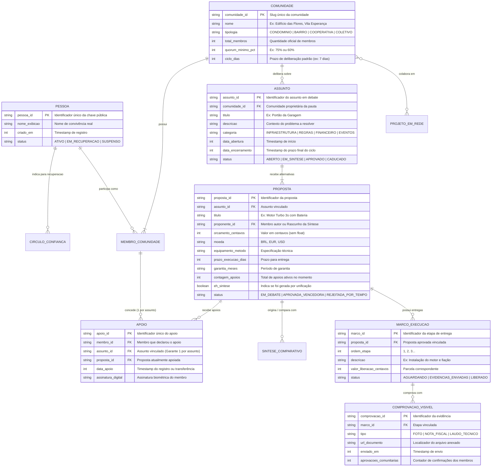
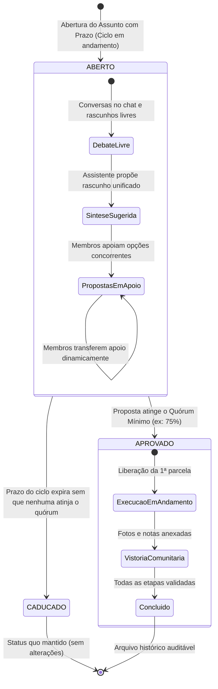

# System Design — Sintetize

**Plataforma de Governança Direta, Síntese e Tomada de Decisão Coletiva**  
**Classificação:** Especificação Canônica de Arquitetura de Sistema (RFC / System Design Document)  
**Versão:** 1.0 — Orientação Centrada no Cidadão  

---

## 1. Visão Geral do Produto e Declaração de Escopo

### 1.1. O Problema Real
Tradicionalmente, grupos humanos (condomínios, cooperativas de trabalho, associações de bairro e coletivos de projetos) enfrentam um dilema desgastante quando precisam tomar decisões conjuntas:
1. **O Caos dos Grupos de Mensagens:** Em aplicativos convencionais de conversa (WhatsApp, Telegram), dezenas de pessoas falando ao mesmo tempo geram ruído extremo. Quem digita o dia todo ou fala mais alto domina a pauta, enquanto a maioria silenciosa se afasta por cansaço.
2. **Assembleias Burocráticas e Ineficientes:** Reuniões presenciais exigem tempo, geram atritos pessoais e quase sempre terminam em decisões apressadas votadas por quem aguentou ficar até o final.
3. **Crítica Vazia e Polarização:** Sistemas tradicionais incentivam a rejeição passiva (o voto de "não" ou a reclamação que nada propõe), paralisando projetos necessários por falta de alternativas estruturadas.

### 1.2. A Proposta de Valor do Sintetize
O **Sintetize** é um software desenhado para **aproximar vontades, sintetizar ideias e promover acordos claros de forma colaborativa e transparente**. 

O sistema substitui o bate-boca desordenado pela **destilação contínua de propostas estruturadas**:
* **1 Pessoa = 1 Voz Autêntica:** Acesso simples via biometria do próprio smartphone, sem senhas complicadas nem perfis falsos.
* **Propostas Sem Dono com Templates Claros:** Formulários objetivos contendo finalidade, orçamento, responsáveis, prazos e garantias.
* **O Sintetizador de Ideias:** As conversas e contribuições convergem em sínteses unificadas produzidas com o apoio de um assistente inteligente neutro.
* **Diferenças Semânticas Visíveis:** Comparativo direto lado a lado destacando o que é comum e o que diverge (valores, marcas, prazos), sem necessidade de ler textos longos.
* **Apoio Dinâmico (1 Apoio por Assunto):** Você vincula seu apoio a uma única opção por vez, mas pode transferi-lo livremente caso uma alternativa melhor ou combinada surja.
* **Contestação Construtiva Estrita:** Não existe botão de rejeição passiva. Quem discorda apresenta uma alternativa no texto e busca convencer os membros.
* **Execução Segura:** Recursos e prazos são liberados mediante comprovação comunitária visual (fotos, notas fiscais).

### 1.3. Limites de Escopo (Fronteiras Claras)

```mermaid
flowchart TD
    subgraph InScope ["O que o Sintetize É (IN-SCOPE)"]
        direction TB
        IS1["Tomada de decisão direta para comunidades reais"]
        IS2["Apoiamento dinâmico transferível com quórum e ciclo"]
        IS3["Assistente de IA como secretário neutro sem voto"]
        IS4["Comparador semântico de diferenças de negócio"]
        IS5["Identidade biométrica local (Passkeys) com recuperação social"]
        IS6["Colaboração em rede entre comunidades (Federações)"]
    end

    subgraph OutScope ["O que o Sintetize NÃO É (OUT-OF-SCOPE)"]
        direction TB
        OS1["Rede social com feed aberto de likes, views ou seguidores"]
        OS2["Aplicativo de bate-papo infinito sem objetivo de deliberação"]
        OS3["Sistema de governança representativa com cargos permanentes"]
        OS4["Bolsa de apostas, tokens especulativos ou gamificação financeira"]
        OS5["Centralizador de custódia de dados biométricos em nuvem"]
    end
```

---

## 2. Requisitos do Sistema

### 2.1. Requisitos Funcionais (FR)

Os requisitos funcionais cobrem os 8 estágios da experiência do **Sintetize**:

#### Domínio 1: Identidade, Acesso e Proteção Social
* **RF-01 (Autenticação Biométrica Nativa):** O sistema deve autenticar o usuário em até 30 segundos utilizando exclusivamente as credenciais de hardware do próprio aparelho (TouchID, FaceID ou biometria via WebAuthn/Passkeys), destrancando localmente uma chave criptográfica de assinatura pessoal, sem exigir criação ou memorização de senhas alfanuméricas.
* **RF-02 (Princípio 1 Pessoa = 1 Voz):** Cada membro ativo possui exatamente uma identidade reconhecida por comunidade. É proibida a criação de múltiplos perfis pela mesma pessoa ou injeção de contas automatizadas (bots).
* **RF-03 (Recuperação Social via Círculo de Confiança):** Em caso de perda, roubo ou dano do aparelho, o usuário deve ser capaz de recuperar o acesso à sua identidade mediante a validação presencial ou atestada de um círculo de **3 a 5 membros de confiança** previamente indicados da comunidade.
* **RF-04 (Salvaguarda Anti-Coerção):** O sistema deve disponibilizar a inserção de um código alternativo de coação. Quando digitado sob coação física, a interface simula o apoio normalmente na tela para resguardar a integridade do cidadão, mas anula o registro no cômputo oficial da comunidade.

#### Domínio 2: Comunidades e Parâmetros de Governança
* **RF-05 (Tipologias Reais de Comunidade):** O sistema deve permitir a configuração e operação de espaços deliberativos soberanos para:
  1. *Condomínios Residenciais* (ex: alinhamento predial, obras e reformas comuns);
  2. *Associações de Bairro / Moradores* (ex: segurança, melhorias em praças e iluminação);
  3. *Cooperativas e Coletivos de Trabalho* (ex: compra conjunta de maquinário, regras internas);
  4. *Grupos de Amigos e Projetos Locais* (ex: orçamentos de viagens, eventos e fundos conjuntos).
* **RF-06 (Parâmetros da Comunidade):** Cada comunidade deve definir formalmente em sua criação:
  * Quantidade oficial de membros ativos ($M$);
  * Meta de quórum mínimo de aprovação ($Q_{\text{meta}}$, ex: 60%, 75% ou 80%);
  * Duração do ciclo de decisão ($\Delta t_{\text{ciclo}}$, ex: 2, 5 ou 7 dias corridos);
  * Círculo inicial de validadores de novos membros.
* **RF-07 (Autonomia e Não-Interferência):** Nenhuma comunidade tem o poder de interferir, alterar parâmetros ou vetar decisões internas de outra comunidade.

#### Domínio 3: Assuntos, Categorias e Templates
* **RF-08 (Abertura de Assuntos com Prazo):** Qualquer assunto deliberativo (ex: *"Troca do Portão da Garagem"*) deve possuir um prazo final claro ancorado no ciclo da comunidade, exibindo contadores de participação de membros e contagem regressiva viva.
* **RF-09 (Templates Estruturados por Categoria):** O sistema deve oferecer modelos pré-configurados que obrigam o preenchimento dos campos fundamentais:
  * *Finalidade & Local de Aplicação*;
  * *Orçamento Total Estimado* (valor, moeda e condições de pagamento);
  * *Especificação Técnica / Equipamento*;
  * *Prazos de Execução*;
  * *Garantia e Manutenção*.
* **RF-10 (Prevenção de Ambiguidade):** Propostas com textos vagos, ofensivos ou sem parâmetros mínimos de execução não avançam para a fase de apoio público.

#### Domínio 4: O Sintetizador, Diffs Semânticos e Contestação Construtiva
* **RF-11 (O Motor do Sintetizador):** Quando propostas semelhantes ou ideias concorrentes são apresentadas, o sistema deve processar os textos e exibir uma visualização unificada (a Síntese), apontando os pontos de acordo e os pontos de escolha.
* **RF-12 (Comparador Visual de Diferenças Semânticas):** O sistema deve exibir um comparativo objetivo lado a lado entre duas propostas concorrentes ou entre a proposta original e sua síntese:
  * Seção *"O que é idêntico em ambas"* (Finalidade, garantias, critérios gerais);
  * Seção *"O que diverge"* (Orçamento, tecnologia, prazos, fornecedores);
  * Destaque visual: inclusões em **verde** e exclusões em **vermelho tachado**.
* **RF-13 (Contestação Construtiva Obrigatória):** Fica estritamente vedada a existência de botões de rejeição passiva (*"Não Gostei"*, *"Discordo"* ou voto contra sem alternativa). Para discordar de uma proposta, o membro é obrigado a propor uma emenda ou alternativa prática no texto, convencendo os demais a migrarem seu apoio.

#### Domínio 5: Apoiamento Dinâmico e Formação de Consenso
* **RF-14 (Apoio Único por Assunto):** Cada membro da comunidade pode manifestar apoio ativo para no máximo **uma proposta por assunto em pauta**.
* **RF-15 (Transferência Livre e Instantânea de Apoio):** O apoio não é engessado. A qualquer momento antes do término do prazo do ciclo, o cidadão pode transferir seu apoio com 1 toque para outra proposta ou para uma nova versão sintetizada.
* **RF-16 (Cálculo Dinâmico de Quórum em Tempo Real):** O sistema deve recalcular instantaneamente os percentuais de apoio de todas as propostas ativas no momento em que um apoio é registrado ou transferido.
* **RF-17 (Critério de Fechamento e Aprovação):**
  * Se uma proposta atingir a meta de quórum da comunidade ($Q_{\text{meta}}$, ex: 75% dos membros) dentro do prazo do ciclo, ela é declarada **Proposta Consensual Vencedora**.
  * Se o prazo do ciclo expirar e nenhuma proposta atingir a meta de quórum, **o assunto caduca e nenhuma alteração é imposta**, preservando o status quo até que surja uma proposta mais convincente.

#### Domínio 6: Acompanhamento de Entrega e Liberação em Etapas
* **RF-18 (Escrow Comunitário em Fases):** Toda proposta de ação que envolva recursos comunitários deve prever liberação parcelada atrelada a marcos de entrega (ex: 30% no início, 40% na entrega e 30% após vistoria).
* **RF-19 (Comprovação Visível e Avaliação Comunitária):** A liberação de cada parcela exige upload de evidências públicas no sistema (fotos da obra, laudos técnicos, notas fiscais), que passam pela confirmação dos membros da comunidade.

#### Domínio 7: Assistente de Síntese Neutro (IA)
* **RF-20 (Secretário Neutro Sem Poder de Decisão):** O módulo de inteligência artificial deve operar exclusivamente como assistente de redação:
  * Analisar a conversa da sala deliberativa;
  * Extrair os requisitos essenciais colocados pelos participantes;
  * Preencher o template estruturado com clareza;
  * Redigir versões unificadas que combinem as melhores ideias de propostas concorrentes.
* **RF-21 (Veto Total ao Poder de Voto da IA):** A IA **nunca** apoia, não vota, não prioriza participantes e não possui autoridade para aprovar ou rejeitar documentos.
* **RF-22 (Soberania Humana):** Qualquer rascunho formulado pela IA só se torna proposta oficial quando um membro humano da comunidade decide assiná-lo e submetê-lo ao apoio coletivo.

#### Domínio 8: Projetos em Rede (Federações)
* **RF-23 (Colaboração Inter-Comunidades):** Para iniciativas que envolvem múltiplos grupos vizinhos (ex: três blocos de prédios compartilhando uma área de lazer ou associações do mesmo bairro criando uma feira coletiva), as comunidades devem poder abrir um **Projeto em Rede**, deliberando com regras unificadas sem dissolver a autonomia interna de cada grupo.

---

### 2.2. Requisitos Não-Funcionais (NFR)

| Código | Categoria | Especificação / Critério de Aceite |
| :--- | :--- | :--- |
| **RNF-01** | **Acessibilidade Universal** | A interface deve operar com extrema leveza no navegador de qualquer smartphone popular (iOS e Android), sem exigir downloads pesados de lojas corporativas (App Store / Google Play). Conformidade obrigatória com o padrão **WCAG 2.1 Nível AA** (contraste mínimo 4.5:1, áreas de toque mínimas de $44 \times 44\text{ px}$). |
| **RNF-02** | **Velocidade e Ergonomia Cognitiva** | O tempo de carregamento inicial e abertura de um assunto deve ser $\le 1.5\text{ segundo}$ em redes 3G/4G. O comparador visual de diferenças deve permitir que um cidadão compreenda o que mudou em um orçamento ou proposta em menos de 10 segundos. |
| **RNF-03** | **Privacidade e Isolamento Biométrico** | Nenhuma imagem facial, biometria digital ou chave privada pessoal trafega por redes ou fica armazenada em servidores centrais. A biometria fica restrita ao hardware local seguro do usuário (Secure Enclave / Android KeyStore). |
| **RNF-04** | **Arquitetura Descentralizada (Local-First)** | O sistema não deve depender de um servidor central monopolista. O armazenamento e a replicação de dados ocorrem de forma descentralizada e resiliente entre os membros e nós comunitários. Se o sinal de internet cair, a leitura de propostas e histórico continua funcionando offline. |
| **RNF-05** | **Imutabilidade e Não-Repúdio** | Todo apoio e proposta confirmada possui assinatura digital inviolável. Uma vez atingido o quórum e encerrado o ciclo, o resultado gera um registro imutável que nenhuma autoridade pode adulterar ou apagar retroativamente. |
| **RNF-06** | **Confiabilidade da IA (Schema Estrito)** | Qualquer saída gerada pelo assistente de síntese deve obrigatoriamente cumprir um contrato de esquema formal (JSON Schema estrito), garantindo que valores financeiros, prazos e textos estejam devidamente tipados e blindados contra alucinações de formato. |

---

## 3. Modelo de Domínio e Entidades de Dados

A arquitetura de dados do **Sintetize** é estruturada em torno de entidades que refletem com fidelidade as relações do mundo real:

### 3.1. Diagrama Entidade-Relacionamento (ERD)

---

### 3.2. Ciclo de Vida e Máquinas de Estado

#### A. Ciclo de Vida do Assunto

#### B. A Regra do Apoio Móvel e Transferível (Invariante Central)
1. **Regra de Unicidade:** Para cada par `(membro_id, assunto_id)`, existe no máximo **1 registro ativo** de `APOIO`.
2. **Transferência Atômica:** Quando o cidadão clica em *"Apoiar"* em uma nova proposta $P_B$:
   * O apoio anterior em $P_A$ é decrementado instantaneamente ($P_A.\text{contagem} \leftarrow P_A.\text{contagem} - 1$).
   * O apoio na proposta $P_B$ é incrementado ($P_B.\text{contagem} \leftarrow P_B.\text{contagem} + 1$).
   * O sistema recalcula os percentuais de quórum imediatamente.
3. **Imutabilidade Pós-Quórum:** No momento em que uma proposta atinge o quórum estabelecido pela comunidade ($P_X.\text{contagem} / \text{total\_membros} \ge Q_{\text{meta}}$), o assunto é encerrado com vitória daquela proposta e os apoios são congelados de forma definitiva.

---

## 4. Próximos Blocos do System Design (Em Desenvolvimento)

* **Parte 2: Arquitetura de Alto Nível de Software** (Divisão em Camadas: PWA, Motor de Consenso Local, Rede P2P/Relays e Conector de IA).
* **Parte 3: Deep Dive nos Motores Especiais** (Motor de Diffs Semânticos e Motor do Assistente de Síntese).
* **Parte 4: Engenharia de Segurança, Passkeys e Recuperação Social**.
* **Parte 5: Tratamento de Falhas, Casos de Borda e Trade-offs de Arquitetura**.

