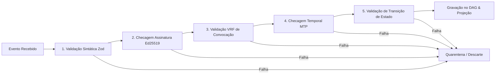

# Especificação Técnica — Fase 2: Integridade Local e Event Sourcing
**PFS-CD (Protocolo Fractal de Síntese e Consenso Dinâmico)**
**Módulos Contemplados:** Bloco 3 (Merkle DAG & Storage) + Bloco 5 (Pipeline de Validação Client-Side)

---

## 1. Objetivo da Fase 2

Implementar a camada de **persistência local imutável orientada a eventos (*event sourcing*)** e o **firewall determinístico do cliente (*validation pipeline*)**. 
Nesta etapa, o nó passa a ser capaz de:
1. Armazenar eventos encadeados criptograficamente (`parent_hashes`).
2. Materializar projeções de leitura (*read models*) para consultas instantâneas.
3. Validar rigorosamente qualquer evento antes de inseri-lo no DAG local.
4. Confinar dados corrompidos ou maliciosos em quarentena sem corromper o estado canônico.

---

## 2. Dependências Open Source

```bash
npm install @sqlite.org/sqlite-wasm dexie isomorphic-git
npm install -D vitest
```

* **`@sqlite.org/sqlite-wasm`**: SQLite oficial em WebAssembly com suporte ao Origin Private File System (OPFS) para armazenamento persistente de alta performance no cliente.
* **`dexie`**: Wrapper tipado sobre IndexedDB (opção alternativa ou de apoio para metadados).
* **`isomorphic-git`**: Motor Git implementado em JavaScript/TypeScript para manipulação de grafos de commits e árvores de objetos se desejado.

---

## 3. Estrutura de Diretórios Recomendada

```
packages/storage/
├── src/
│   ├── dag/
│   │   ├── commit.ts         # Estrutura do nó do Merkle DAG e cálculo de hashes
│   │   ├── tree.ts           # Encadeamento de parent_hashes e detecção de bifurcações
│   │   └── pruning.ts        # Garbage collection de eventos inativos
│   ├── db/
│   │   ├── schema.sql        # Esquema relacional das tabelas locais
│   │   ├── connection.ts     # Inicialização do SQLite WASM / Dexie
│   │   └── projections.ts    # Materializador de estado (Event Handlers)
│   ├── validator/
│   │   ├── pipeline.ts       # Execução sequencial dos passos de verificação
│   │   ├── rules/
│   │   │   ├── sig_check.ts  # Checagem de assinatura Ed25519
│   │   │   ├── vrf_check.ts  # Validação de convocação no nó
│   │   │   ├── mtp_check.ts  # Checagem contra Median Time Past
│   │   │   └── state_check.ts# Validação de regras de consenso
│   │   └── quarantine.ts     # Isolamento de forks e commits inválidos
│   └── index.ts
└── test/
    ├── dag_integrity.spec.ts
    ├── projections.spec.ts
    └── pipeline_validation.spec.ts
```

---

## 4. O Nó do Merkle DAG e Event Sourcing

Cada transição de estado é um `StateEventCommit` imutável. 

```typescript
export interface StateEventCommit {
  commit_hash: string;            // SHA-256 do payload canônico
  parent_hashes: string[];        // Hashes dos commits pais (1 para sequência linear, >=2 para merge)
  timestamp: number;              // Timestamp de emissão
  community_id: string;           // Identificador da comunidade
  cell_node_id: string;           // Célula N1 deliberante
  action_type: 
    | "CREATE_PROPOSAL"
    | "CAST_MIGRATION_VOTE"
    | "SUGGEST_BRANCH_EDIT"
    | "SYNTHESIZE_MERGE";
  payload: {
    persona_id: string;
    proposal_target_id: string;
    previous_target_id?: string;
    patch_diff?: string;          // Emenda em formato unificado
    vrf_proof: string;
  };
  calculated_delta: {
    new_votes: number;
    new_remaining_seconds: number;
    target_closure_timestamp: number;
  };
  signature: string;              // Assinatura Ed25519 da Persona
}
```

### Cálculo Determinístico do `commit_hash`
```typescript
import { sha256 } from "@noble/hashes/sha256";
import { bytesToHex } from "@noble/hashes/utils";

export function computeCommitHash(eventWithoutHash: Omit<StateEventCommit, "commit_hash" | "signature">): string {
  // Serialização canônica determinística (RFC 8785)
  const canonicalString = canonicalJsonStringify(eventWithoutHash);
  const hashBytes = sha256(new TextEncoder().encode(canonicalString));
  return bytesToHex(hashBytes);
}
```

---

## 5. Esquema Relacional de Projeções (SQLite Local)

O Merkle DAG é a fonte da verdade (*write model*). Para consultas rápidas da interface (*read model*), mantemos um banco SQLite local atualizado a cada novo commit válido:

```sql
-- Tabela de Projeção de Propostas Ativas
CREATE TABLE IF NOT EXISTS proposals_projection (
    proposal_id TEXT PRIMARY KEY,
    community_id TEXT NOT NULL,
    current_status TEXT NOT NULL,
    current_votes INTEGER NOT NULL DEFAULT 0,
    quorum_min INTEGER NOT NULL,
    t0_first_quorum INTEGER,
    target_closure_timestamp INTEGER,
    latest_commit_hash TEXT NOT NULL,
    updated_at INTEGER NOT NULL
);

-- Tabela de Votos Atuais por Persona
CREATE TABLE IF NOT EXISTS active_votes_projection (
    persona_id TEXT NOT NULL,
    community_id TEXT NOT NULL,
    proposal_id TEXT NOT NULL,
    cell_node_id TEXT NOT NULL,
    voted_at INTEGER NOT NULL,
    PRIMARY KEY (persona_id, community_id)
);

-- Tabela de Histórico de Commits (Merkle DAG Store)
CREATE TABLE IF NOT EXISTS dag_commits (
    commit_hash TEXT PRIMARY KEY,
    parent_hashes_json TEXT NOT NULL,
    payload_json TEXT NOT NULL,
    is_canonical BOOLEAN NOT NULL DEFAULT 1,
    created_at INTEGER NOT NULL
);
```

---

## 6. Pipeline de Validação Client-Side (Firewall Determinístico)

O validador é construído como uma esteira de funções puras. Se qualquer checagem falhar, o evento é rejeitado com um código de erro específico e enviado para a quarentena.



### Implementação do Pipeline

```typescript
export type ValidationResult = 
  | { success: true }
  | { success: false; errorCode: string; reason: string };

export class EventValidatorPipeline {
  static async validate(commit: StateEventCommit, db: LocalDatabase): Promise<ValidationResult> {
    // 1. Validação Estrutural
    const parseResult = StateEventCommitSchema.safeParse(commit);
    if (!parseResult.success) {
      return { success: false, errorCode: "ERR_INVALID_SCHEMA", reason: parseResult.error.message };
    }

    // 2. Validação Criptográfica de Assinatura
    const isSigValid = await verifyEd25519Signature(
      commit.signature,
      commit.commit_hash,
      commit.payload.persona_id
    );
    if (!isSigValid) {
      return { success: false, errorCode: "ERR_BAD_SIGNATURE", reason: "Assinatura Ed25519 inválida" };
    }

    // 3. Validação de Elegibilidade Celular (VRF)
    const isElected = await verifyVrfElection(
      commit.payload.persona_id,
      commit.cell_node_id,
      commit.payload.vrf_proof
    );
    if (!isElected) {
      return { success: false, errorCode: "ERR_NOT_IN_CELL", reason: "Persona não convocada nesta célula" };
    }

    // 4. Validação Temporal contra MTP (Median Time Past)
    const mtp = await db.getMedianTimePast(commit.community_id);
    if (commit.timestamp < mtp) {
      return { success: false, errorCode: "ERR_TIMESTAMP_PAST", reason: "Timestamp anterior ao tempo de rede" };
    }

    // 5. Validação de Transição de Estado
    const stateValid = await db.verifyStateTransitionLegality(commit);
    if (!stateValid.valid) {
      return { success: false, errorCode: "ERR_ILLEGAL_TRANSITION", reason: stateValid.reason };
    }

    return { success: true };
  }
}
```

---

## 7. Critérios de Aceite (Definition of Done)

1. **Integridade de Grafo:** O motor rejeita qualquer commit cujos `parent_hashes` não existam ou tenham histórico quebrado.
2. **Reversibilidade Zero:** Tentativas de alterar commits passados alteram o hash SHA-256 e quebram todas as referências filhas.
3. **Resistência a Ataques:** O pipeline barra assinaturas forjadas, votos de pessoas fora da célula e tentativas de votar com timestamps adulterados.
4. **Idempotência:** A ingestão do mesmo commit múltiplas vezes não duplica votos nem corrompe a projeção.
