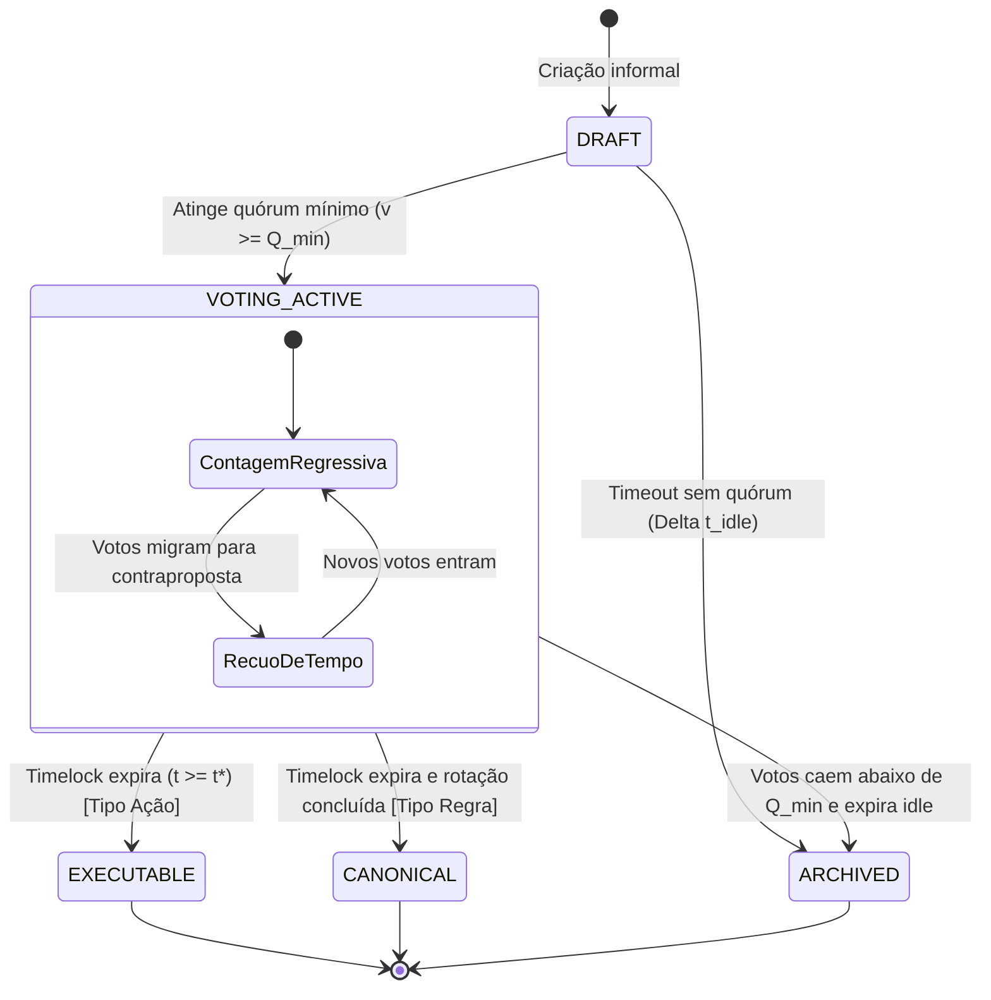

# Modelo de Domínio e Dicionário de Dados Canônico
**PFS-CD (Protocolo Fractal de Síntese e Consenso Dinâmico)**
**Classificação:** Especificação Normativa de Tipagem, Invariantes e Limites de Dados

---

## 1. Visão Geral e Princípios de Modelagem

Este documento estabelece o modelo de dados canônico do protocolo PFS-CD. Todos os módulos (Core, Storage, Network, Validator e UI) devem obrigatoriamente respeitar as definições, tipos primitivos, restrições de tamanho e máquinas de estado aqui formalizadas.

### Princípios Inegociáveis:
1. **Identificadores Canônicos (URNs):** Todas as entidades possuem IDs estruturados em formato URN com validação estrita por expressões regulares.
2. **Precisão Criptográfica e Monetária:** Proibido uso de ponto flutuante em valores monetários e contadores. Valores monetários devem ser armazenados em inteiros representando a menor fração da moeda (ex: centavos). Timestamps são inteiros UNIX em segundos UTC.
3. **Limites de Tamanho Rígidos (Anti-DoS):** Nenhum campo de texto é ilimitado. Textos possuem limites mínimos (para evitar spam vazio) e máximos (para evitar exaustão de memória e saturação da rede P2P).
4. **Imutabilidade e Autoria Despersonalizada:** Propostas e eventos não possuem mantenedores com privilégios de controle.

---

## 2. Padrões de Identificadores (URNs) e Regex

| Entidade | Formato URN Canônico | Padrão Regex de Validação | Exemplo |
| :--- | :--- | :--- | :--- |
| **Persona** | `0x<hex40>` | `^0x[a-fA-F0-9]{40}$` | `0x4f9a882c7d91e4a3b7c2018274659f8c12a0e3d1` |
| **Community** | `urn:pfscd:comm:<slug>:<ano>` | `^urn:pfscd:comm:[a-z0-9-]{3,64}:[0-9]{4}$` | `urn:pfscd:comm:bairro-central-sp:2026` |
| **Cell Node** | `urn:pfscd:node:<cell_id>` | `^urn:pfscd:node:[a-z0-9-]{3,64}$` | `urn:pfscd:node:n1-cell-42` |
| **Proposal** | `urn:pfscd:prop:<slug>:<hash8>` | `^urn:pfscd:prop:[a-z0-9-]{3,64}:[a-f0-9]{8}$` | `urn:pfscd:prop:iluminacao-praca:a1b2c3d4` |
| **Commit Hash** | `<hex64>` (SHA-256) | `^[a-f0-9]{64}$` | `9f83c21a4e5b6d7c8e9f...` |
| **Signature** | `<hex128>` (Ed25519) | `^[a-f0-9]{128}$` | `304402202b8d9c...` |

---

## 3. Especificação Detalhada das Entidades

### 3.1. Entidade: `Persona`
Representa o agente individual soberano, ancorado em Prova de Humanidade e par de chaves assimétricas `Ed25519`.

* **Identificador:** `persona_id` (Hexadecimal de 40 caracteres derivado do SHA-256 da chave pública).
* **Campos e Restrições:**
  * `public_key` (`string`, hex de 64 caracteres): Chave pública `Ed25519`.
  * `created_at` (`integer`, uint32): Timestamp UNIX em segundos.
  * `status` (`enum`): `"ACTIVE" | "EJECTED_LOCAL" | "SUSPENDED"`.
  * `vouch_count` (`integer`, 0 a 100): Quantidade de atestações por pares recebidas.
* **Invariantes:**
  * Uma Persona nunca pode ser excluída globalmente da rede (apenas de comunidades específicas via processo de ejeção qualificada).
  * Não existem métricas públicas de reputação cumulativa ou contadores de seguidores.

---

### 3.2. Entidade: `Community`
Espaço deliberativo delimitado geográfica ou tematicamente.

* **Identificador:** `community_id` (URN canônica).
* **Campos e Restrições:**
  * `name` (`string`, 3 a 128 caracteres, sem tags HTML/scripts).
  * `scope` (`enum`): `"TERRITORIAL" | "THEMATIC" | "COOPERATIVE" | "INSTITUTIONAL"`.
  * `genesis_timestamp` (`integer`, uint32): Criação da comunidade.
  * `founder_persona_id` (`string`, URN Persona): Proponente de gênese.
  * `parameters` (`object`):
    * `node_size_k` (`integer`, padrão: 10, faixa permitida: 5 a 20).
    * `buffer_size_beta` (`integer`, padrão: 3, faixa permitida: 1 a 5).
    * `default_quorum_min` (`integer`, padrão: 5, piso: 3, teto: `node_size_k`).
    * `default_time_max_seconds` (`integer`, padrão: 864.000 = 10 dias, mín: 86.400 = 1 dia, máx: 2.592.000 = 30 dias).
    * `default_grace_period_seconds` (`integer`, padrão: 172.800 = 2 dias, mín: 43.200 = 12h).
    * `decay_exponent_alpha` (`float`, padrão: 1.5, faixa permitida: 1.0 a 3.0).
    * `idle_timeout_seconds` (`integer`, padrão: 604.800 = 7 dias).
    * `inactivity_archive_seconds` (`integer`, padrão: 15.552.000 = 180 dias).
  * `status` (`enum`): `"ACTIVE" | "DISSOLVING" | "READ-ONLY_ARCHIVED"`.

---

### 3.3. Entidade: `Proposal`
Objeto informacional polimórfico vivo em deliberação.

* **Identificador:** `proposal_id` (URN canônica).
* **Tipos de Proposta (`proposal_type`):**
  * `ACTION_DEADLINE`: Plano executável com orçamento, trabalho e cronograma.
  * `CANONICAL_RULE`: Estatutos, regras comunitárias e normas perenes.
  * `FACT_EVIDENCE`: Aferição e atestação epistêmica de fatos/notícias.
  * `INCUBATOR`: Discussões abertas, consultas e ideação reflexiva sem timelock terminal.
* **Campos de Conteúdo (`template_data`):**
  * `problem` (`string`, 10 a 5.000 caracteres UTF-8): Descrição do problema ou motivação.
  * `solution` (`string`, 10 a 10.000 caracteres UTF-8): Especificação da proposta ou texto normativo.
  * `resources` (`object`, opcional para `INCUBATOR`, obrigatório para `ACTION_DEADLINE` antes do quórum):
    * `budget_cents` (`integer`, não-negativo, máximo: 100.000.000.000 = R$ 1 bilhão): Valor em centavos inteiros.
    * `currency` (`string`, 3 caracteres ISO 4217, ex: `"BRL"`, `"USD"`).
    * `labor_execution` (`string`, 5 a 500 caracteres): Responsáveis ou comissão executora.
  * `success_metrics` (`array` de `string`, 0 a 10 itens, cada item de 5 a 300 caracteres): Indicadores auditáveis.
* **Metadados de Estado Dinâmico:**
  * `current_status` (`enum`): `"DRAFT" | "VOTING_ACTIVE" | "EXECUTABLE" | "CANONICAL" | "ARCHIVED"`.
  * `current_votes` (`integer`, não-negativo, máximo: `node_size_k`).
  * `ancestor_hash` (`string` de 64 caracteres ou `null` se for raiz).
  * `t0_first_quorum_timestamp` (`integer` ou `null`).
  * `target_closure_timestamp` (`integer` ou `null`).

---

### 3.4. Entidade: `Cell` (Nó Celular $N_1$)
A unidade celular de deliberação elementar.

* **Identificador:** `cell_node_id` (URN canônica).
* **Campos:**
  * `community_id` (`string`, URN Community).
  * `active_members` (`array` de `persona_id`, tamanho exato $\le K = 10$).
  * `buffer_members` (`array` de `persona_id`, tamanho exato $\le \beta = 3$).
  * `current_proposal_ids` (`array` de `proposal_id`, propostas ativas sob debate na célula).
  * `status` (`enum`): `"DELIBERATION_ACTIVE" | "BUFFER_OVERFLOW" | "SPLIT_COMPLETED" | "CLOSED"`.
  * `created_at` (`integer`).

---

### 3.5. Entidade: `StateEventCommit` (Evento do Merkle DAG)
Unidade atômica imutável que registra qualquer mutação de estado.

* **Identificador:** `commit_hash` (SHA-256 canônico).
* **Campos:**
  * `parent_hashes` (`array` de `string`, hashes SHA-256; exatamente 1 pai para fluxo linear, $\ge 2$ para merge).
  * `timestamp` (`integer`, uint32).
  * `community_id` (`string`).
  * `cell_node_id` (`string`).
  * `action_type` (`enum`):
    * `"CREATE_PROPOSAL"`
    * `"CAST_MIGRATION_VOTE"`
    * `"SUGGEST_BRANCH_EDIT"`
    * `"SYNTHESIZE_MERGE"`
    * `"EJECT_MEMBER"`
    * `"DISSOLVE_COMMUNITY"`
  * `payload` (`object`, tamanho máximo total: 100 KB):
    * `persona_id` (`string`).
    * `proposal_target_id` (`string`).
    * `previous_target_id` (`string`, opcional para migração).
    * `patch_diff` (`string`, opcional para branches, formato unificado RFC 3986/diff).
    * `vrf_proof` (`string`, prova criptográfica da convocação).
  * `calculated_delta` (`object`): Atualizações determinísticas calculadas para a proposta alvo.
  * `signature` (`string`, assinatura Ed25519 de 128 caracteres hexadecimais).

---

### 3.6. Entidade: `EphemeralChatMessage` (Câmara Deliberativa)
Mensagem efêmera descartável trocada entre os membros da célula. **Nunca é gravada no Merkle DAG.**

* **Identificador:** `message_id` (UUIDv4).
* **Campos:**
  * `cell_node_id` (`string`, URN da célula).
  * `sender_persona_id` (`string`, Persona do autor).
  * `content_type` (`enum`): `"TEXT" | "AUDIO_SNIPPET" | "SYSTEM_AI_SUMMARY"`.
  * `content` (`string`, máximo 2.000 caracteres para texto ou URL de blob temporário local para áudio).
  * `timestamp` (`integer`, uint32).
  * `expires_at` (`integer`, timestamp de auto-destruição).

---

## 4. Máquinas de Estados Formais

### 4.1. Máquina de Estados da Proposta (`Proposal`)

#### Transições Proibidas:
* É estritamente proibido transitar de `ARCHIVED` para `VOTING_ACTIVE` (uma proposta morta exige novo commit de criação).
* É proibido transitar de `EXECUTABLE` ou `CANONICAL` para qualquer outro estado (imutabilidade do consenso finalizado).

---

### 4.2. Máquina de Estados da Célula ($N_1$)

```mermaid
stateDiagram-v2
    [*] --> DELIBERATION_ACTIVE : Início (Lotação <= 10)
    DELIBERATION_ACTIVE --> BUFFER_OVERFLOW : Membros entre 11 e 12
    BUFFER_OVERFLOW --> DELIBERATION_ACTIVE : Membros recuam <= 10
    BUFFER_OVERFLOW --> SPLIT_COMPLETED : Atinge 13 membros (Clivagem Atômica)
    
    SPLIT_COMPLETED --> [*] : Célula original fecha; gera semente filha
```

---

## 5. Limites de Dados e Políticas Anti-DoS

Para garantir a viabilidade em nós de baixa potência (smartphones e Raspberry Pis), aplicam-se os seguintes tetos absolutos de memória e rede:

| Parâmetro | Limite Mínimo | Limite Máximo | Ação em caso de Violação |
| :--- | :--- | :--- | :--- |
| **Payload do Commit** | 100 bytes | 100 Kilobytes | Rejeição sumária na camada Gossip |
| **Texto de Problema** | 10 caracteres | 5.000 caracteres | Erro de validação Zod no cliente |
| **Texto de Solução** | 10 caracteres | 10.000 caracteres | Erro de validação Zod no cliente |
| **Mensagem de Chat** | 1 caractere | 2.000 caracteres | Truncamento ou rejeição no cliente |
| **Áudio Efêmero** | 1 segundo | 60 segundos | Limite de gravação no cliente |
| **Propostas Ativas por Célula** | 1 | 10 | Bloqueio de novas propostas na célula |
| **Parent Hashes por Commit** | 1 | 8 | Rejeição por complexidade excessiva de merge |
