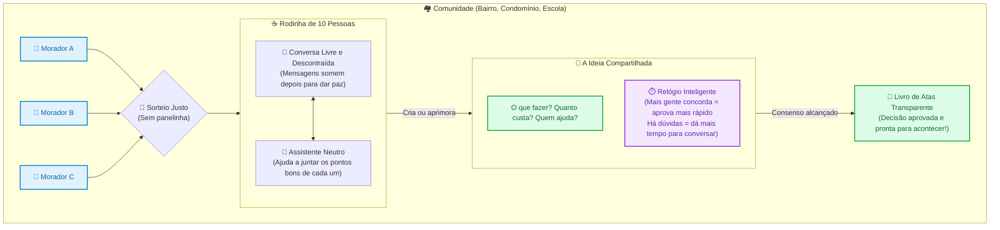

# 🌟 Visão Geral: O que é este Software e Como Ele Funciona?

> **Resumo em uma única frase:**  
> Este software é um organizador digital de boas ideias que reúne as pessoas em mesas de até 10 pessoas, elimina o ódio e as vaidades da internet e transforma conversas do dia a dia em melhorias concretas para o mundo real.

---

## 1. O que é este projeto? (A Grande Ideia)

Pense neste aplicativo como uma **"sala de reunião inteligente e pacífica"** para as pessoas resolverem problemas reais do dia a dia (no condomínio, no bairro, na escola, em cooperativas ou até na cidade).

Hoje, quando tentamos discutir algo em grupos de WhatsApp ou redes sociais, o resultado costuma ser brigas, discussões infinitas, boatos e pessoas gritando umas com as outras. Já na política tradicional, pouquíssimas pessoas decidem tudo sozinhas enquanto a maioria só assiste.

Este software foi desenhado para mudar essa história: ele ajuda as pessoas a **conversarem em pequenos grupos, juntarem suas ideias e chegarem a acordos práticos sem brigas, sem líderes autoritários e sem perda de tempo**.

---

## 2. Quem são as "Personagens" e Entidades envolvidas?

Para fazer o sistema funcionar de maneira justa, existem alguns elementos principais:

| Entidade / Personagem | Quem é no "Mundo Real"? | O que faz no sistema? |
| :--- | :--- | :--- |
| **A Pessoa (`Persona`)** | O cidadão comum (você, seu vizinho, um colega). | Dá sua opinião, vota e colabora. **Regra de ouro:** Aqui não existem contadores de curtidas, seguidores nem fama. Uma pessoa real = exatamente uma voz. |
| **A Comunidade (`Community`)** | O espaço comum onde as pessoas convivem. | Pode ser um condomínio, uma associação de bairro, uma cooperativa ou uma escola. Cada comunidade define seus próprios assuntos. |
| **A Mesa dos 10 (`Cell` / Célula)** | Um grupo pequeno de no máximo **10 pessoas**. | Em vez de colocar 500 pessoas falando ao mesmo tempo em uma sala barulhenta, o sistema reúne grupos de 10 vizinhos para conversar com calma e respeito. |
| **A Ideia ou Proposta (`Proposal`)** | O plano concreto para resolver um problema. | Pode ser consertar a lâmpada da rua, organizar uma festa, criar uma nova regra ou checar se um boato é verdade. **Não tem dono:** depois que você sugere, a ideia vira do grupo para ser melhorada por todos. |
| **O Livro de Decisões (`Merkle DAG`)** | O livro de atas digital e inviolável. | Um caderno transparente que registra as decisões finais. Ninguém consegue apagar nem mudar nada escondido depois que o grupo aprovou. |
| **O Assistente Neutro (IA Co-Piloto)** | Uma ajudante eletrônica inteligente. | Lê a conversa do bate-papo, identifica onde todos concordam e redige um rascunho bonito para o grupo avaliar. Ela **nunca** decide nem vota; quem manda são sempre as pessoas de carne e osso. |

---

## 3. Como tudo se conecta: O Fluxo do Sistema

---

## 4. Regras do Jogo: Como ele evita brigas e injustiças?

O sistema foi desenhado com regras muito bem pensadas, inspiradas no bom senso do dia a dia:

### 1. "Não basta reclamar, tem que propor uma alternativa"
Nas redes sociais, é comum pessoas criticarem sem construir nada. Aqui, para barrar uma ideia que você não gosta, **não existe botão de 'não curti'**. Você precisa redigir uma ideia alternativa melhor e convencer os colegas a apoiarem a sua versão. Assim, toda energia é canalizada para criar soluções em vez de brigas.

### 2. O Relógio Inteligente  
O sistema não tem prazos burocráticos engessados:
* Se quase todo mundo do grupo concordou rapidamente com uma ideia (por exemplo, 9 ou 10 pessoas), o relógio anda mais rápido e aprova logo.
* Se os votos ficarem divididos ou se alguém trouxer uma sugestão alternativa convincente, o relógio automaticamente ganha mais dias para que todos conversem com calma.

### 3. A Sala de Conversa que "apaga as mensagens"
Dentro da rodinha de 10 pessoas, existe um bate-papo informal (texto e áudio). Esse bate-papo é **descartável**: quando o grupo chega a um acordo e a proposta é escrita, as conversas antigas somem. Ninguém precisa ter medo de falar uma besteira ou mudar de opinião, pois só o que fica gravado para sempre é o documento final aprovado.

### 4. A Roda Giratória (Sem "caciques" nem políticos de carreira)
Quando uma ideia precisa ir para um nível maior (do bairro para a cidade toda, por exemplo), o sistema sorteia **novas pessoas** para avaliar o próximo passo. Ninguém vira "chefe eterno" da rodinha nem ganha poderes especiais.

### 5. Se a rodinha encher, ela cria uma nova irmã
O número ideal de conversa são 10 pessoas. Se entrarem mais pessoas interessadas naquele tema (até 13), o grupo original conclui seu trabalho e os membros excedentes formam o núcleo de uma nova rodinha irmã, convidando outros moradores sorteados. Todos têm espaço para falar.

### 6. Direito de seguir seu próprio caminho
Se uma comunidade não concordar mais entre si, a maioria não pode simplesmente "calar" a minoria. Qualquer grupo menor tem o direito garantido de copiar todo o histórico de ideias já criado e continuar seu próprio caminho de forma independente e pacífica.

---

## 5. Que tipos de problemas esse sistema resolve?

As propostas podem ter 4 formatos simples:
1. **Mão na Massa (`Ação com Prazo`):** Coisas práticas que precisam de data, valor e responsáveis (ex: *"Festa de Dia das Crianças no bairro"* ou *"Pintura da quadra de esportes"*).
2. **Regras de Convivência (`Normativa / Lei`):** Regras duradouras para o grupo (ex: *"Regulamento de barulho após as 22h"* ou *"Estatuto da cooperativa"*).
3. **Checagem de Notícias (`Fato / Evidência`):** Investigar juntos se uma história que circulou no bairro é um boato falso ou uma verdade com provas.
4. **Espaço de Ideias (`Incubadora`):** Debates abertos para sonhar projetos a longo prazo que ainda não têm data certa para acontecer.

---

## 6. O Poder dos Dados Distribuídos: Por que Ninguém Pode Derrubar ou Fraudar o Sistema?

Na maioria dos aplicativos que usamos (WhatsApp, redes sociais, sistemas de governo), **todos os dados ficam trancados no computador de uma única empresa ou autoridade central**. 

Isso gera grandes perigos:
* Se a empresa quiser, ela pode apagar sua conta, esconder postagens ou mudar as regras.
* Se um hacker invadir o servidor central, ele pode roubar dados de milhões de pessoas.
* Se um governo autoritário ou político poderoso mandar desligar o servidor, tudo desaparece da noite para o dia.

### Como este software resolve isso? A analogia do "Cartório dos Mil Cadernos"

Neste projeto, **não existe um servidor central ou chefe**. Ele funciona de uma forma muito mais segura e distribuída:

1. **O Caderno Compartilhado no Celular de Cada Um:**  
   Em vez de um servidor só no meio do mundo, cada morador participante guarda uma cópia idêntica do livro de decisões no seu próprio celular. É como se 1.000 pessoas tivessem exatamente o mesmo caderno em suas casas.
2. **Impossível Fraudar ou Mudar o Passado:**  
   Se um vizinho mal-intencionado tentar adulterar o resultado de uma votação no próprio aparelho para trapacear, os outros 999 cadernos comparam as informações automaticamente e dizem: *"Essa folha foi alterada, nós rejeitamos!"*. Para fraudar algo, alguém teria que invadir os celulares de quase todo mundo ao mesmo tempo — o que é matematicamente impossível.
3. **Sua Assinatura é Inviolável:**  
   Quando você vota ou apoia uma proposta, você assina com a segurança do seu próprio aparelho (usando a sua digital ou reconhecimento facial). Ninguém no mundo pode forjar o seu voto ou fingir ser você.
4. **Imune a Censura e Bloqueios:**  
   Como a rede conversa de celular para celular (como uma conversa entre vizinhos na calçada), não existe um "botão de desligar". Nenhum prefeito, síndico, hacker ou empresa tem o poder de apagar as decisões da comunidade.

> **O Poder Real desta Tecnologia:**  
> A comunidade se torna **verdadeiramente soberana**. As pessoas não dependem da boa vontade de políticos ou donos de redes sociais para que suas vontades sejam respeitadas. A decisão do povo é protegida pela matemática e gravada para sempre.

---

## 7. Como Funciona em Grandes Comunidades? A Regra das Mesas de 10

Uma das maiores dúvidas é: *"Se o sistema usa mesinhas de apenas 10 pessoas, como isso funciona em um bairro de 1.000 moradores ou numa cidade inteira?"*

A regra de ouro é: **SÃO SEMPRE MESAS DE ATÉ 10 PESSOAS!**  
Os nós superiores seguem exatamente a mesma regra das mesas base, existindo apenas para **sintetizar ideias** para que a comunidade não precise ler dezenas ou centenas de propostas:

### 1. A Escada de Síntese
* **10 Pessoas (1 Mesa Base):** 10 vizinhos conversando em volta da mesa sobre o problema e formulando 1 proposta.
* **30 Pessoas (3 Mesas Base ➔ 1 Mesa Superior com 3 Assentos Ocupados):**  
  As 3 mesas de 10 vizinhos criam suas visões. A Mesa Superior tem capacidade para 10 lugares, mas **apenas 3 assentos estão ocupados** (1 representante sorteado de cada mesa base) e 7 vagas livres. Esses 3 representantes unem as ideias numa síntese comum. **Assim ninguém precisa ler 30 propostas!**
* **100 Pessoas (10 Mesas Base ➔ 1 Mesa Superior com 10 Assentos):**  
  As 10 mesas base enviam 1 representante cada. A Mesa Superior atinge a capacidade máxima de 10 assentos ocupados.

### 2. A Dinâmica da Subida: Coesão e Dúvidas Reais
O que o representante sorteado leva para a mesa superior depende do que aconteceu na sua mesa:
* **Mesa com Alta Coesão (Consenso Forte):** Se os 10 vizinhos debateram e concordaram amplamente, a pessoa sorteada obviamente sobe levando com ela essa proposta clara e respaldada.
* **Mesa com Baixa Adesão (Dúvidas e Dilemas):** Se o grupo teve opiniões divididas ou não soube como resolver um problema prático (ex: segurança, viabilidade), a pessoa **não inventa um consenso falso**: ela sobe levando exatamente essas dúvidas para a mesa superior.
* **O Encontro no Topo (A Peça que Faltava):** Na mesa superior, é muito comum que a proposta formulada por outro grupo resolva justamente a dúvida que a segunda mesa levou! Assim, as visões se complementam e geram uma síntese madura.

### 3. Soberania Individual: Você Pode Apoiar a Proposta de Qualquer Nó
A mesa superior existe para **ajudar a melhorar e sintetizar**, evitando que as pessoas tenham que ler dezenas de textos desconexos. Porém:
* **A mesa de cima nunca impõe uma decisão.**
* **Você continua 100% livre para manter e apoiar a sua proposta como escolhida de qualquer nó ou mesa.**
* O poder final de apoio é sempre direto de cada morador. A síntese é um facilitador para enriquecer as ideias, nunca um filtro autoritário.

### 4. O Sorteio Justo: "Sua hora vai chegar"
Para evitar que os mesmos moradores de sempre virem "donos do microfone", o sistema usa um sorteio sequencial:
* **Aleatório:** Ninguém prevê quem será o próximo chamado, impedindo conchavos e politicagem.
* **Sequencial (Roda Giratória):** A lista de moradores gira continuamente. Ninguém fica de fora: a vez de todo mundo chega.

### 📌 Princípios Fundamentais da Rede:
1. **Sempre Mesas de 10:** Tanto na base quanto no topo, o debate é sempre em grupos pequenos de até 10 pessoas.
2. **Para Não Ler 50 Propostas:** As mesas superiores servem apenas para sintetizar e resumir soluções, poupando a atenção da comunidade.
3. **Liberdade de Apoio:** Qualquer pessoa pode apoiar a proposta de qualquer nó ou mesa.
4. **Cadeiras Rotativas:** Ninguém é dono de cargo. O sorteio garante que todos participem com igualdade.

---

## 8. Como Funciona uma Proposta na Prática?

Muitas pessoas desistem de participar de reuniões comunitárias porque odeiam burocracia, documentos longos e termos jurídicos indecifráveis. Neste software, criar, comparar e lapidar propostas é tão simples, visual e rápido quanto usar os melhores aplicativos do cotidiano.

### 8.1 O Formato da Proposta: Tão Fácil quanto um Google Forms

Em vez de exigir a redação de um "projeto de lei" ou documento formal com parágrafos jurídicos, o sistema guia qualquer cidadão através de um **formulário simples e acolhedor em blocos**, idêntico à experiência de responder um Google Forms:

| Bloco do Formulário | O que a pessoa responde | Exemplo Real (Revitalização da Praça) |
| :--- | :--- | :--- |
| **1. O Problema Real** | Qual dor do dia a dia estamos resolvendo? | *"A praça fica no escuro depois das 19h e os moradores têm medo de circular à noite."* |
| **2. A Ação Prática** | O que faremos concretamente para resolver? | *"Instalar 6 refletores de energia solar automática com postes de fixação nos canteiros centrais."* |
| **3. Recursos & Custo** | Quanto custa e o que será necessário? | *"R$ 1.200 (compra dos refletores solares online). Sem custo de eletricidade mensal."* |
| **4. Responsáveis & Prazo** | Quem se compromete a ajudar e até quando? | *"Mariana e Seu Jorge compram os refletores; mutirão de instalação no sábado 18/11."* |
| **5. Como Medir o Sucesso** | Como saberemos que deu certo daqui a 30 dias? | *"Praça iluminada todas as noites e aumento de famílias caminhando após o jantar."* |

O sistema oferece modelos prontos para cada tipo de assunto (Reformas/Ações, Regras de Convivência, Checagem de Fatos ou Espaço de Ideias), com perguntas direcionadas que impedem propostas vagas ou enrolação.

---

### 8.2 Comparando Propostas com a Lógica "Git Diff" (Mas com uma Interface Limpa e Elegante)

Na política tradicional, quando alguém propõe uma alteração ou contraproposta, as pessoas são forçadas a reler um documento inteiro dezenas de vezes para tentar descobrir o que mudou.

No Sintetizando, usamos o conceito dos programadores chamado **"diff" (comparação de diferenças)**, mas adaptado com um design **100% amigável para o cidadão comum**:

* 🟢 **Em verde sutil (`+ Adicionado`):** As melhorias ou novas garantias inseridas.
* 🔴 **Em vermelho sutil (`- Removido / Riscado`):** Ideias antigas, custos cortados ou partes descartadas pelo grupo.
* ⚪ **Em cinza neutro (`= Mantido`):** Os pontos em que todos já concordavam e permaneceram intactos.

#### Exemplo Visual de Comparação:
> **Proposta Original vs. Síntese Ajustada pela Mesa:**
> * **Ação:** Instalação de refletores solares nos canteiros da praça. *(Mantido)*
> * **Custo:** ~~R$ 3.500 (fiação subterrânea ligada ao poste do condomínio)~~ ➔ **R$ 1.200 (refletores solares autônomos sem quebra de piso)** *(Economia de R$ 2.300!)*
> * **Regra:** **+ "Sensor de luz automática com timer até às 23h para não perturbar as janelas dos apartamentos vizinhos."** *(Novo ponto acolhido para respeitar o descanso de todos)*

Com esse visual, em **menos de 30 segundos** qualquer pessoa bate o olho e compreende exatamente:
1. O que foi melhorado;
2. Quanto dinheiro foi economizado;
3. Qual dúvida de vizinho foi respondida na nova versão.

---

### 8.3 O Chat da Mesa e o Co-Piloto de IA: Do "Papo Solto" ao Acordo Pronto

Em cada mesa de 10 pessoas, existe um bate-papo descontraído (por texto e mensagens de voz transcritas). No cantinho da conversa, atua o **Assistente Neutro de IA**:

1. **A conversa informal:** O morador não precisa saber como escrever bonito. Ele pode apenas desabafar:  
   * *"Gente, tá muito escuro na quadra. Quase caí ontem no degrau. A gente tinha que dar um jeito nisso logo!"*
2. **A IA organiza e enriquece:** O assistente identifica que existe um problema comum, analisa propostas semelhantes já bem-sucedidas em outras comunidades e sugere gentilmente na conversa:  
   * *"💡 Moradores, notei a preocupação com a segurança na quadra. Posso estruturar isso no formato de proposta da comunidade? Fiz um orçamento preliminar de fitas de LED solares ou refletores (média de R$ 400 a R$ 1.200). Desejam que eu gere o rascunho?"*
3. **Refinamento colaborativo:** Os vizinhos comentam: *"Ótimo, mas vamos colocar que o mutirão é no sábado à tarde"*.
4. **O Formulário Pronto com 1 Clique:** Com um toque no botão *"Gerar Proposta Estruturada"*, a IA preenche o formulário estilo Google Forms com os dados discutidos.
5. **Quem manda é a pessoa:** A IA **nunca** publica nem vota por ninguém. Ela apenas entrega a caneta: o morador revisa, faz os ajustes que quiser e coloca na mesa para os 10 vizinhos apoiarem e decidirem.

