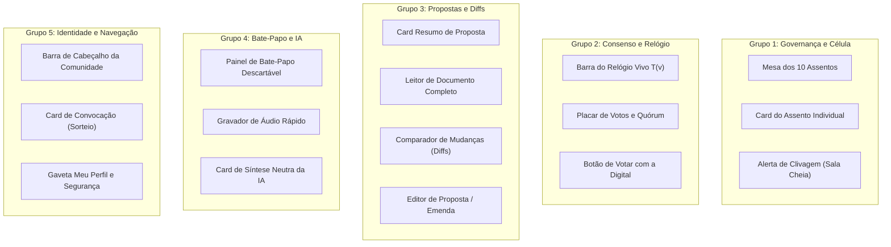

# Catálogo e Mapa de Componentes do Aplicativo
**PFS-CD (Protocolo Fractal de Síntese e Consenso Dinâmico)**

Este documento organiza todos os blocos de construção visual da interface. Os componentes foram agrupados por área de responsabilidade, descritos em **texto simples**, sem poluição de código, servindo como guia claro para quando formos programar.

---

## 🗺️ Mapa de Componentes por Grupo e Telas

---

## 📋 Divisão dos Documentos Detalhados

Cada documento explica a função de cada componente, o que ele recebe de informação e o que ele faz quando a pessoa clica:

0. **[00. Componentes Genéricos e Design System](file:///Users/MarcosBaiadori/Desktop/sintetizing/docs/components/00_componentes_genericos.md):**
   * Padrões profissionais de tipografia (H1-H4, leitura de propostas), paleta de cores neutras e semânticas, botões, inputs, cards, modais, abas, badges, tooltips e esqueletos de carregamento.
1. **[01. Governança e Célula](file:///Users/MarcosBaiadori/Desktop/sintetizing/docs/components/01_governanca_e_celula.md):**
   * Os assentos da mesa de 10 pessoas, a fila de espera e o aviso de divisão da sala.
2. **[02. Consenso e Relógio Vivo](file:///Users/MarcosBaiadori/Desktop/sintetizing/docs/components/02_consenso_e_relogio.md):**
   * O cronômetro que estica e encolhe, o placar de adesão e a confirmação biométrica de votos.
3. **[03. Propostas e Comparações (Diffs)](file:///Users/MarcosBaiadori/Desktop/sintetizing/docs/components/03_propostas_e_diffs.md):**
   * Visualização da proposta, texto tachado/sublinhado de mudanças e bloco de notas para sugerir ideias.
4. **[04. Bate-Papo Efêmero e Inteligência Artificial](file:///Users/MarcosBaiadori/Desktop/sintetizing/docs/components/04_batepapo_e_ia.md):**
   * A sala de conversa descartável, mensagens de áudio e o botão da IA que resume a conversa.
5. **[05. Identidade, Navegação e Avisos](file:///Users/MarcosBaiadori/Desktop/sintetizing/docs/components/05_identidade_e_navegacao.md):**
   * O cabeçalho do bairro, o aviso de que você foi sorteado e a gestão da sua chave digital.
