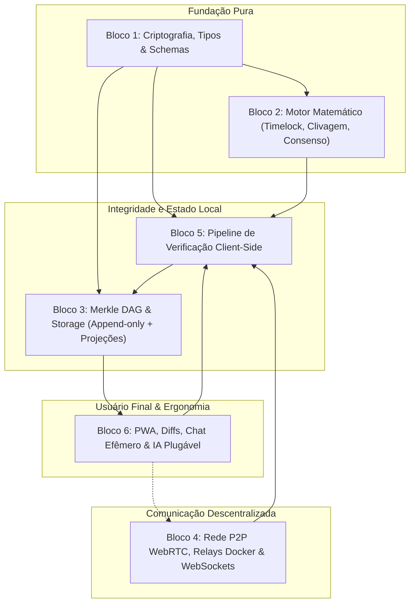
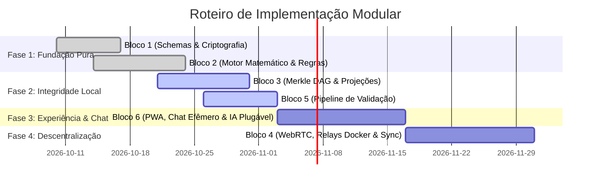

# Plano de Arquitetura e Implementação Modular — PFS-CD

**Protocolo Fractal de Síntese e Consenso Dinâmico (Versão 2.2)**

Este documento detalha a decomposição arquitetural do protocolo em blocos modulares e desacoplados, permitindo o desenvolvimento, teste e evolução independente de cada camada e componente do sistema.

---

## 1. Visão Geral da Arquitetura

O objetivo desta decomposição é separar as regras matemáticas e criptográficas determinísticas da infraestrutura de rede, persistência e interface de usuário. Isso garante que:

1. As regras de consenso e transição possam ser testadas com 100% de previsibilidade (*pure functions*, sem I/O).
2. O armazenamento e a topologia de grafo funcionem como um log local imutável (*event sourcing*).
3. A camada de rede P2P seja intercambiável ou mockável para testes de integração.
4. A interface gráfica consuma uma API de alto nível fornecida pelo validador local, sem exigir que o cidadão domine conceitos técnicos.

---

## 2. Diagrama de Dependências entre Blocos

---

## 3. Especificação dos 6 Grandes Blocos

### Bloco 1: Criptografia, Tipos e Esquemas (`Core & Schemas`)

* **Responsabilidade:** Biblioteca base com primitivas criptográficas, estruturas de dados tipadas e esquemas canônicos.
* **Componentes Principais:**
  * **Schemas Canônicos:** JSON Schemas estritos para validação de `CommunityGenesis`, `ProposalObject` e `StateEventCommit`.
  * **Criptografia Assimétrica e Passkeys:** Geração de chaves, assinatura e verificação utilizando chaves `Ed25519` nativas ou derivadas via WebAuthn/Passkeys (biometria segura).
  * **Hashing e Canonicalização:** Hashing `SHA-256` sobre representações determinísticas (JSON canônico RFC 8785).
  * **VRF (Verifiable Random Function):** Mecanismo de sorteio com comprovação criptográfica para convocação aleatória de membros.
  * **Identidade Soberana (`Persona`):** Identificador derivado da chave pública, esquemas de *peer-vouching* e proteção Anti-Sybil.
* **Sem dependências externas de rede ou I/O:** Biblioteca pura e determinística.

---

### Bloco 2: Motor Matemático e Topologia Celular (`Consensus Engine`)

* **Responsabilidade:** Lógica determinística e regras da teoria dos jogos que governam a deliberação coletiva.
* **Componentes Principais:**
  * **Princípio da Autoria Despersonalizada (Propostas Sem Dono):** Toda proposta pertence ao domínio comum da célula; não há mantenedores com poder de veto.
  * **Equação de Timelock Dinâmico:** Implementação da função de decaimento temporal:
    $$
    T(v) = \begin{cases} \infty, & v < Q_{\text{min}} \\ T_{\text{max}} \cdot \left(\frac{K - v}{K - Q_{\text{min}}}\right)^\alpha, & Q_{\text{min}} \le v < K - 1 \\ T_{\text{grace}}, & v = K - 1 \\ 0, & v = K \end{cases}
    $$
  * **Critério de Fechamento Irrefutável:** Determinação exata de encerramento de votação ($t^*$).
  * **Topologia Celular ($N_1$):**
    * Tamanho base $K = 10$.
    * Amortecimento e buffer $\beta = 3$ (capacidade máxima $K + \beta = 13$).
    * Gatilho de clivagem atômica ($\text{Trigger}_{\text{split}}$) redistribuindo excedentes com convocação VRF.
  * **Contestação Construtiva via Diffs/Branches:** Criação de emendas incrementais a partir de propostas existentes sem retrabalho de redação integral.
  * **Fusão de Síntese:** Mecânica de migração de votos para novas versões consolidadas negociadas na célula.
  * **Ascensão Fractal e Rotação Sequencial:** Rotação compulsória de assentos para nós de nível superior ($N_2, N_3$).

---

### Bloco 3: Grafo de Eventos e Persistência Local (`Merkle DAG & Storage`)

* **Responsabilidade:** Armazenamento seguro orientado a eventos (*event sourcing*) e cálculo de projeções de estado.
* **Componentes Principais:**
  * **Append-Only Merkle DAG Store:** Armazena commits imutáveis indexados por seu `commit_hash`, mantendo links para `parent_hashes`.
  * **Separação Ruído vs. Sinal:** Armazena apenas o resultado final cristalizado (propostas e votos). Conversas efêmeras jamais entram no DAG.
  * **Projeção de Estado Atual (Read Models):** Banco de dados relacional ou chave-valor local (SQLite/IndexedDB/RocksDB) que materializa:
    * Estado de cada comunidade e seus parâmetros $\Omega_C$.
    * Propostas ativas, ramos alternativos (*branches*), votos agregados e prazos correntes.
    * Histórico de membros ativos por célula/nó.
  * **Snapshots e Arquivamento:** Garbage collection de propostas inativas ($\Delta t_{\text{idle}}$) e congelamento de comunidades inativas (> 180 dias) para leitura fria.

---

### Bloco 4: Camada de Rede P2P, Relays e Comunicação Efêmera (`Networking & Gossip`)

* **Responsabilidade:** Descoberta de pares, transporte de mensagens e propagação de eventos sem intermediários centrais ou dependência de lojas corporativas.
* **Componentes Principais:**
  * **Arquitetura Resiliente em Duas Camadas:**
    * **Light Clients (PWA no Smartphone/Browser):** Sincronizam deltas do Merkle DAG sob demanda sem drenar bateria e sem exigir conexão P2P persistente 24/7.
    * **Nós Relays Cegos (Blind Relays via WebSockets):** Servidores comunitários neutros e sem custódia. Qualquer pessoa sobe um relay com **1 comando Docker** (`docker run -d -p 8080:8080 sintetizing/relay`) para manter a rede online e tolerante a censura.
  * **Comunicação Direta WebRTC:** Conexão direta celular-a-celular para os 10 membros da célula deliberativa ativa, com latência zero e custo nulo, utilizando os Relays WebSockets apenas para sinalização inicial (troca de SDP/ICE).
  * **Transporte Efêmero sem Custódia:** O bate-papo de 10 pessoas é transmitido de forma volátil e criptografada, expirando imediatamente após a consolidação da célula, sem poluir o Merkle DAG.
  * **Protocolo de Sincronização (DAG Sync):** Reconciliação rápida de branches e commits faltantes quando nós móveis se reconectam (Offline-First).
  * **Cálculo de MTP (Median Time Past):** Proteção contra adulterações no relógio local.

---

### Bloco 5: Pipeline de Verificação Client-Side (`Client Verification Daemon`)

* **Responsabilidade:** Atuar como firewall determinístico do nó, validando rigorosamente todo evento recebido antes da persistência ou redistribuição.
* **Fases do Pipeline de Validação:**
  1. **Validação Estrutural:** Conformidade com o JSON Schema do evento.
  2. **Validação Criptográfica:** Verificação da assinatura digital `Ed25519` contra a `Persona` emissora.
  3. **Validação de Convocação:** Verificação da semente VRF garantindo que a Persona tem assento ativo na célula.
  4. **Validação Temporal:** Checagem da janela de oportunidade contra o tempo de rede (MTP).
  5. **Validação de Transição de Estado:** Garantia de que a ação respeita o estado anterior da proposta no Merkle DAG (quórum legal, branches válidos).
* **Quarentena de Maliciosos:** Eventos que violam regras são descartados sem propagação, isolando nós maliciosos em forks sem consenso.

---

### Bloco 6: Interface do Usuário, Ergonomia e Assistente de Síntese (`UI & Client App`)

* **Responsabilidade:** Proporcionar uma experiência humana fluida, sem jargões criptográficos, reduzindo drasticamente o esforço cognitivo do cidadão.
* **Componentes Principais:**
  * **PWA Super Leve (Progressive Web App):** Instalação direta do navegador sem aprovação da Apple Store ou Google Play, resistente à censura e com cache offline nativo.
  * **Autenticação Biométrica Invisível (Passkeys + Ed25519):** O hardware do smartphone (TouchID/FaceID) protege a semente criptográfica local, assinando transações com Ed25519 sem exigir anotação de frases mnemônicas de 12 palavras.
  * **Câmara Deliberativa Efêmera (Chat da Célula $N_1$):** Sala de conversa informal, com texto e áudios curtos, totalmente descartável (auto-destrutível após a consolidação).
  * **Visualizador de Diffs Humanizado:** Renderização de emendas e ramificações como sugestões visuais (verde para inclusões, vermelho para exclusões), permitindo comparar e migrar votos com 1 clique.
  * **IA Sintetizadora Plugável (Interface Padrão):** Módulo desacoplado com suporte a modelos locais via **Ollama** (Llama 3, Mistral, Qwen) ou APIs externas padronizadas. A IA recebe os JSONs concorrentes e devolve um JSON unificado estrito validado por Schema (Zod), atuando exclusivamente como secretária neutra sem poder decisório.
  * **Monitor de Consenso em Tempo Real:** Cronômetro dinâmico exibindo $T(v)$ e o impacto visual de cada novo voto ou migração.

---

## 4. Matriz de Composição Open Source (Ferramentas Existentes)

O PFS-CD não exige pesquisa e desenvolvimento de baixo nível do zero. A arquitetura se baseia na **composição de tecnologias open source maduras**, auditadas e amplamente adotadas pela indústria:

| Bloco Arquitetural                            | O Que Precisamos Resolver                                                                                                               | Ferramentas Open Source Selecionadas                                                                                                                                                                                                        | Justificativa Técnica                                                                                                                                                                                                                                                               |
| :-------------------------------------------- | :-------------------------------------------------------------------------------------------------------------------------------------- | :------------------------------------------------------------------------------------------------------------------------------------------------------------------------------------------------------------------------------------------ | :----------------------------------------------------------------------------------------------------------------------------------------------------------------------------------------------------------------------------------------------------------------------------------- |
| **Bloco 1: Cripto & Identidade**        | • Chaves Ed25519 • Passkeys / Biometria • Validação de Schemas                                                                       | • **`@noble/ed25519`** & **`@noble/hashes`** • **`@simplewebauthn`** • **`Zod`** / **`Ajv`**                                                                                                        | • As libs `@noble` são padrão ouro (auditadas, zero dependências). • `@simplewebauthn` conecta ao Secure Enclave/KeyStore. • `Zod` valida schemas JSON com tipagem estrita total.                                                            |
| **Bloco 2: Diffs, Branches & Consenso** | • Comparação de texto (Diffs) • Versionamento sem conflito • Máquina de Estados da Proposta                                         | • **`Yjs`** / **`Automerge`** (CRDTs) • **`diff-match-patch`** (Google) • **`XState`**                                                                                                                     | • CRDTs resolvem branches, merges e edição colaborativa em tempo real. • `diff-match-patch` calcula diffs semânticos visuais. • `XState` formaliza a máquina de estados das propostas.                                                            |
| **Bloco 3: Merkle DAG & Storage**       | • Armazenamento Append-Only • Merkle DAG de commits • Banco de dados local                                                             | • **`isomorphic-git`** / **Merkle DAG Core** • **`SQLite WASM`** (com OPFS) ou **`IndexedDB`**                                                                                                        | • Estrutura em Merkle DAG garante imutabilidade e integridade matemática. • SQLite WASM / IndexedDB mantém o estado materializado no dispositivo com persistência offline.                                                                         |
| **Bloco 4: Rede P2P, Relays & Chat**    | • Conexão direta na célula • Relays sem custódia 24/7 • Chat efêmero descartável                                                         | • **`WebRTC DataChannels`** • **`WebSockets`** (Nós Relays Cegos) • **`Docker`** (deploy em 1 comando)                                                                                              | • WebRTC permite troca direta celular-a-celular sem custo de tráfego. • Relays Cegos WebSockets roteiam envelopes assinados sem inspecionar ou alterar dados. • Docker viabiliza descentralização comunitária instantânea.                  |
| **Bloco 5: Validador do Cliente**       | • Pipeline de checagem determinística                                                                                                 | • TypeScript puro + Middleware funcional (estilo **`tRPC`** / **`Koa`**)                                                                                                                                                          | • Cadeia de validações puras (*pipes*): assinatura, quórum, MTP e invariantes.                                                                                                                                                                                                 |
| **Bloco 6: UI, PWA & IA Sintetizadora** | • PWA super leve e soberano • Componentes base acessíveis • Gestão de estado reativo • Editor com sugestões • IA sintetizadora plugável | • **`PWA`** (Vite + Service Workers) • **`shadcn/ui`** + **`Radix`** • **`Zustand`** • **`Tiptap`** + **`Yjs`** • **`Ollama`** / **APIs REST** (Interface padronizada com Zod) | • PWA instala direto do navegador sem dependência de App Stores. • `shadcn/ui` + `Radix` garantem acessibilidade WCAG AA. • `Zustand` gerencia estado reativo (<1KB). • IA plugável via JSON Schemas garante síntese neutra e zero vendor lock-in. |

### Diferencial Exclusivo do Projeto (Regras Proprietárias)

Todo o ecossistema acima entra como infraestrutura pronta. O núcleo proprietário do PFS-CD concentra-se exclusivamente em:

1. **A Função de Timelock Dinâmico $T(v)$** modulando a contração do cronômetro.
2. **A Mecânica de Célula de 10 participantes ($K=10$) com $\beta$-Split e VRF**.
3. **A Contestação Construtiva Estrita** (ausência de voto negativo passivo, apenas migração de votos para emendas).

---

## 5. Fases de Implementação Recomendadas

### Detalhamento e Documentos Específicos por Fase

Cada etapa possui um documento técnico próprio de especificação com dependências, código de exemplo, interfaces TypeScript e critérios de aceite:

1. **[Fase 1 — Fundação Pura](file:///Users/MarcosBaiadori/Desktop/sintetizing/docs/01_fase1_fundacao_pura.md):**
   * Schemas canônicos com Zod, assinaturas `Ed25519` via `@noble`, Passkeys (`@simplewebauthn`), cálculo determinístico do timelock $T(v)$ e regras de divisão celular $K=10, \beta=3$.
2. **[Fase 2 — Integridade Local e Event Sourcing](file:///Users/MarcosBaiadori/Desktop/sintetizing/docs/02_fase2_integridade_local.md):**
   * Append-only Merkle DAG, projeções relacionais em SQLite WASM / IndexedDB, pipeline determinístico de validação em 5 passos e isolamento de forks em quarentena.
3. **[Fase 3 — Aplicação do Cidadão, PWA, Chat Efêmero e IA Plugável](file:///Users/MarcosBaiadori/Desktop/sintetizing/docs/03_fase3_aplicacao_experiencia.md):**
   * PWA super leve instalável direto do navegador sem App Stores, editor Tiptap + Yjs para diffs amigáveis de contrapropostas, sala de chat descartável da célula, IA sintetizadora plugável via interface padrão (Ollama ou APIs com Schemas Zod) e simulador multi-persona.
4. **[Fase 4 — Rede P2P, Relays Cegos Docker e Descentralização](file:///Users/MarcosBaiadori/Desktop/sintetizing/docs/04_fase4_descentralizacao_p2p.md):**
   * Arquitetura em duas camadas (Light Clients PWA em smartphones + Relays neutros cegos via Docker), comunicação direta WebRTC entre participantes da célula, difusão WebSocket resiliente e reconciliação offline-first do Merkle DAG.

