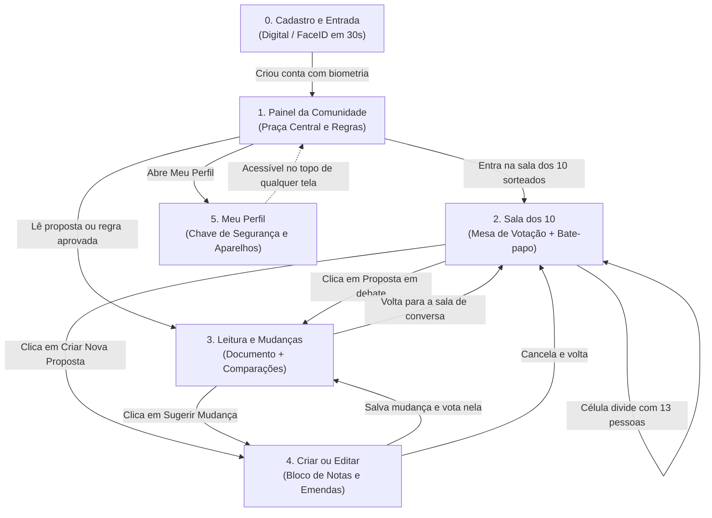

# Guia e Mapa das Telas do Aplicativo (Views)

**PFS-CD (Protocolo Fractal de Síntese e Consenso Dinâmico)**

Este documento resume a jornada do cidadão pelo aplicativo e conecta todas as 6 telas principais, escritas em linguagem simples e acessível.

---

## 🗺️ Mapa de Navegação entre as Telas

---

## 📋 Lista de Telas Documentadas

1. **[00. Cadastro e Entrada Simples](file:///Users/MarcosBaiadori/Desktop/sintetizing/docs/views/00_cadastro_e_entrada.md)** (`/cadastro`):
   * Criação de conta em 30 segundos usando apenas nome e biometria do celular (Passkeys). Zero senhas difíceis.
2. **[01. Painel da Comunidade](file:///Users/MarcosBaiadori/Desktop/sintetizing/docs/views/01_painel_da_comunidade.md)** (`/c/:idComunidade`):
   * Visão geral do bairro/comunidade, card de convocação para os sorteados, propostas ativas e acervo de regras aprovadas.
3. **[02. Sala dos 10 (Conversa e Voto)](file:///Users/MarcosBaiadori/Desktop/sintetizing/docs/views/02_sala_dos_10_conversa_e_voto.md)** (`/c/:idComunidade/celula/:idCelula`):
   * A mesa com as 10 cadeiras mostrando os votos ao vivo, o relógio dinâmico que estica ou acelera, e o bate-papo descartável com suporte a áudio e resumo por IA.
4. **[03. Leitura e Comparação da Proposta](file:///Users/MarcosBaiadori/Desktop/sintetizing/docs/views/03_leitura_e_mudancas_proposta.md)** (`/c/:idComunidade/proposta/:idProposta`):
   * Leitura agradável do documento completo com comparações visuais de emendas (sugestões em verde e tachadas em vermelho estilo Word/Google Docs).
5. **[04. Criação e Edição de Proposta](file:///Users/MarcosBaiadori/Desktop/sintetizing/docs/views/04_criar_ou_editar_proposta.md)** (`/c/:idComunidade/proposta/nova`):
   * Bloco de notas simples para escrever ideias ou propor emendas em documentos existentes sem barreiras burocráticas.
6. **[05. Meu Perfil e Segurança](file:///Users/MarcosBaiadori/Desktop/sintetizing/docs/views/05_perfil_e_seguranca.md)** (`/perfil`):
   * Gerenciamento de aparelhos conectados, proteção biométrica, comunidades ativas e garantias de privacidade.
