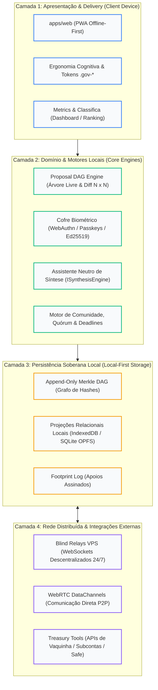

# RFC-000: Sintetize System Architecture & Master Specification

**Documento:** `system-design/00_OVERVIEW.md`
**Status:** Canonical / Living Document
**Tipo:** System Design Document (Architecture RFC)
**Autor:** Projeto Sintetize Core Team
**Última Atualização:** 2026-11-04

---

## 1. Visão Executiva e Declaração de Missão

O **Sintetize** é uma infraestrutura de software distribuída (Local-First), horizontal e resistente à censura, desenhada para permitir que comunidades humanas (condomínios, cooperativas, associações de moradores, coletivos de trabalho) tomem decisões diretas, transparentes e auditáveis sem a intermediação de burocracias lentas, assembleias manipuladas ou oligarquias de controle.

### O Princípio Fundamental

> **Quem controla o fluxo de informação e as ferramentas de decisão controla o destino das pessoas.**O Sintetize fundamenta-se em duas premissas inegociáveis:
>
> 1. **O poder de se expressar livremente:** Qualquer pessoa pode, a qualquer momento, propor qualquer alternativa partindo de qualquer ponto da história.
> 2. **O poder de escolher livremente:** Cada pessoa apoia de forma soberana a proposta que melhor lhe serve, podendo migrar seu apoio dinamicamente quando uma ideia superior for apresentada.

---

## 2. Diagrama de Arquitetura em 4 Camadas

O sistema é dividido em quatro camadas desacopladas com fluxo unidirecional de dependência:

---

## 3. Matriz dos 6 Blocos Canônicos de Engenharia

| Módulo             | Documento           | Responsabilidade Primária                                                                                                                      | Entidades Chave                                                                                  |
| :------------------ | :------------------ | :---------------------------------------------------------------------------------------------------------------------------------------------- | :----------------------------------------------------------------------------------------------- |
| **Community** | `01_COMMUNITY.md` | Federações, categorias, privacidade, convites, inatividade, quórum dinâmico e recursos/vaquinhas.                                           | `Community`, `Subject`, `Federation`, `Category`, `CommunityConfigs`, `TreasuryTool` |
| **Proposal**  | `02_PROPOSAL.md`  | Árvore aberta (DAG), campos livres, Diff universal$N \times N$, congelamento temporal e execução com fotos.                                | `ProposalNode`, `ProposalField`, `DiffResult`, `ExecutionProof`, `PickCounter`         |
| **Person**    | `03_PERSON.md`    | Identidade biométrica (Passkeys), apoio móvel transferível (`Pick`), rastro imutável (`Footprint`), atestação e recuperação social. | `Person`, `IdentityKey`, `PickEvent`, `FootprintEntry`, `TrustCircle`                  |
| **AI**        | `04_AI.md`        | Escuta do diálogo livre (`Chat time`), filtragem de ruído emocional, motor `sintetize` e geração de rascunhos tipados via Zod.          | `SynthesisPrompt`, `ChatTranscript`, `AiDraftResponse`, `SynthesisConvergenceMap`        |
| **P2P**       | `05_P2P.md`       | Rede distribuída, nós móveis (`Person`), relays comunitários (`VPS`), propagação de `Alerts` e reconciliação offline.             | `SignedEnvelope`, `RelayPool`, `DeltaSyncProtocol`, `AlertPacket`                        |
| **Interface** | `06_INTERFACE.md` | UX simplificada, acessibilidade WCAG 2.1 AA, delivery PWA soberano e placares analíticos (`Metrics & Classifica`).                           | `DesignTokens`, `ComponentCatalog`, `ServiceWorkerCache`, `QuorumMetricsWidget`          |

---

## 4. Invariantes Globais do Sistema (The Invariants)

Toda implementação técnica do **Sintetize** deve respeitar obrigatoriamente as seguintes regras sob pena de rejeição automática de pacotes de rede:

1. **[Invariante]() 1 — Soberania Pessoal (1 Pessoa = 1 Voz):** Nenhum membro possui mais de um voto/apoio ativo por `Subject`, independentemente de poder aquisitivo ou posses físicas na comunidade.
2. **Invariante 2 — Mobilidade do Apoio:** O `Pick` nunca é definitivo até o congelamento da proposta. O cidadão pode transferi-lo para qualquer outro nó da árvore a qualquer momento.
3. **Invariante 3 — Imutabilidade por Hashing Canônico:** Toda proposta, emenda e evento de apoio é indexado pelo hash SHA-256 de seu conteúdo canônico (RFC 8785). Qualquer alteração retroativa quebra as assinaturas filhas.
4. **Invariante 4 — Não-Autoridade da IA:** A inteligência artificial opera como processo determinístico de redação auxiliar. Ela não tem chave de assinatura válida para emitir `Picks` e nunca pode votar ou vetar.
5. **Invariante 5 — Congelamento com Execução Aberta:** Ao atingir o prazo com o quórum necessário, o corpo da proposta é travado de forma estrita. Somente a seção de execução recebe novos dados (evidências e confirmações de entrega).
6. **Invariante 6 — Meta-Governança Aberta:** Nenhum usuário tem privilégio de "admin" para alterar configurações de quórum ou prazos. Configurações só são alteradas por propostas deliberadas e aprovadas com quórum.
