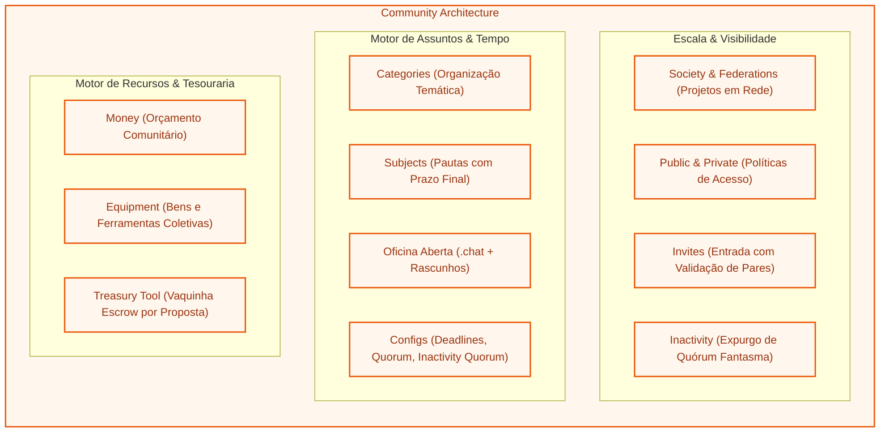
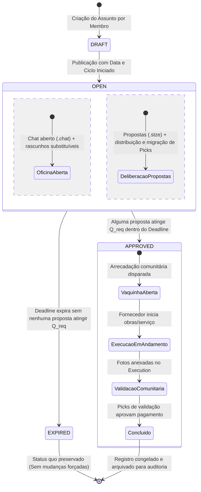

# RFC-001: Community, Federations & Resource Architecture

**Documento:** `system-design/01_COMMUNITY.md`  
**Status:** Canonical / Living Document  
**Tipo:** System Design Document (Domain Module Spec)  
**Autor:** Projeto Sintetize Core Team  
**Última Atualização:** 2026-11-04  

---

## 1. Visão Geral e Fronteiras de Domínio

O módulo **Community** estabelece o espaço soberano de deliberação. Uma comunidade pode ser um condomínio residencial, um coletivo de trabalho, uma cooperativa agrícola ou uma associação de bairro.

### Responsabilidades do Módulo:
1. **Topologia de Escopo:** Gerenciar comunidades privadas (fechadas a convidados) e públicas (abertas à leitura).
2. **Escala Multinível (Society & Federations):** Permitir a federação de comunidades autônomas para projetos compartilhados.
3. **Ciclo de Vida do Assunto (Subject):** Orquestrar categorias, prazos (`Deadlines`), a Oficina aberta (`.chat`) e a máquina de estados.
4. **Resolução de Quórum Fantasma (Inactivity):** Calcular a massa votante real expurgando membros inativos de forma matemática.
5. **Integração de Recursos (Treasury & Vaquinhas):** Gerenciar fundos e equipamentos comuns através de subcontas/vaquinhas atreladas a propostas sem intermediários individuais de custódia.



---

## 2. Especificação Formal dos Componentes

### 2.1. Society & Federations (Projetos em Rede)
Quando duas ou mais comunidades (ex: Bloco A e Bloco B de um condomínio ou associações vizinhas) decidem colaborar:
* É criado um nó de **`Federation`** vinculando as comunidades participantes;
* Os `Subjects` federados tramitam simultaneamente para todos os membros das comunidades vinculadas;
* **Invariante de Soberania:** Cada comunidade participante mantém intacta a sua governança interna, suas finanças locais e suas regras próprias de convivência.

### 2.2. A Matemática do Quórum Dinâmico e Prevenção de Quórum Fantasma
Um dos maiores vetores de falha em DAOs e condomínios é o **Quórum Fantasma**: se membros se mudam ou abandonam o aplicativo, o total nominal de cadastrados infla e a meta de aprovação torna-se inalcançável.

O Sintetize calcula o quórum efetivo com a seguinte formulação:

$$\text{Membros Efetivos } (M_{\text{eff}}) = M_{\text{total}} - M_{\text{inativos}}$$

$$\text{Quórum Absoluto Exigido } (Q_{\text{req}}) = \left\lceil M_{\text{eff}} \times \frac{Q_{\text{meta}}}{100} \right\rceil$$

* **Critério de Inatividade:** Um membro é classificado como `INACTIVE_STANDBY` se não manifestar nenhum `Pick`, login ou interação por $N$ ciclos consecutivos (parâmetro `inactivityThresholdCycles`, padrão = 3).
* **Reativação Automática:** No milissegundo em que um membro inativo abre o aplicativo e manifesta um `Pick`, seu status reverte instantaneamente para `ACTIVE` e o $M_{\text{eff}}$ do assunto é recalculado de forma atômica.

### 2.3. O Ciclo do Subject e a Oficina Aberta (`.chat` + Rascunhos Vivos)
O chat não possui janela fechada nem prazo configurável no `.cmnt` — ele nasce aberto junto com o `Subject` e **não bloqueia** a publicação nem a deliberação de propostas `.stze`:
* **Oficina Contínua (`.chat`):** Funciona como espaço colaborativo permanente enquanto o assunto existir, reunindo mensagens leves de debate e **Rascunhos Vivos** individuais/substituíveis por autor (`CHAT_DRAFT`), onde membros lapidam ideias antes de publicá-las;
* **Publicação em Paralelo (`.stze`):** A qualquer momento — antes, durante ou depois das conversas na Oficina — membros ativos podem publicar propostas imutáveis `.stze` diretamente ou converter um rascunho lapidado em proposta oficial e distribuir `Picks`.

### 2.4. A Arquitetura de Tesouraria: O Modelo de Vaquinha por Proposta
Para garantir **custódia zero** (nenhum morador ou síndico fica com o dinheiro na própria conta corrente correndo risco de apropriação indevida ou penhora):
1. Toda proposta aprovada que envolva movimentação financeira aciona o provedor configurado em `TreasuryTool` (via API de subcontas, PIX Escrow ou contrato multisig Safe);
2. A ferramenta gera um cofre/vaquinha com **destinatário carimbado** (exclusivamente o CNPJ/Chave do prestador homologado no template);
3. Os moradores aportam sua cota parte diretamente para a vaquinha;
4. O valor fica retido e blindado até que as fotos e evidências da entrega física sejam aprovadas no módulo `Proposal -> Execution`.

---

## 3. Máquina de Estados Formal do Subject



---

## 4. Contratos de Dados TypeScript (Schema de Engenharia)

```typescript
export type CommunityScope = "PRIVATE" | "PUBLIC";
export type CommunityType = "CONDO" | "NEIGHBORHOOD" | "COOPERATIVE" | "COLLECTIVE";

export interface CommunityConfigs {
  defaultCycleDays: number;         // Duração padrão do ciclo (ex: 7)
  defaultQuorumPct: number;         // Meta percentual (ex: 75)
  inactivityThresholdCycles: number;// Ciclos sem ação para considerar inativo (ex: 3)
  antiSnipingHoursTrigger: number;  // Janela final de vigilância (ex: 12)
  antiSnipingExtensionHours: number;// Tempo adicionado em caso de virada (ex: 24)
}

export interface TreasuryToolProvider {
  type: "PIX_ESCROW_SUBACCOUNT" | "MULTISIG_SAFE" | "HYBRID_BANK_FEED";
  endpointUrl?: string;
  treasuryIdentifier: string;       // ID da conta/cofre coletivo
  autoReleaseOnQuorum: boolean;
}

export interface CommunityResources {
  treasury: TreasuryToolProvider;
  equipmentRegistry: {
    equipmentId: string;
    name: string;
    serialOrCode?: string;
    status: "OPERATIONAL" | "MAINTENANCE" | "RETIRED";
    custodianPersonaId?: string;
  }[];
}

export interface Community {
  communityId: string;              // URN: "urn:sintetize:comm:<slug>"
  name: string;
  type: CommunityType;
  scope: CommunityScope;
  categories: string[];             // Ex: ["Infraestrutura", "Regras", "Financeiro"]
  configs: CommunityConfigs;
  resources: CommunityResources;
  federationIds?: string[];
  createdAt: number;
}

export interface Subject {
  subjectId: string;                // URN: "urn:sintetize:subj:<slug>:<hash8>"
  communityId: string;
  federationId?: string;
  category: string;
  title: string;
  description: string;
  startedAt: number;
  deadlineTimestamp: number;
  activeProposalsCount: number;
  leadingProposalId: string | null;
  status: "OPEN" | "APPROVED" | "EXPIRED";
}
```
