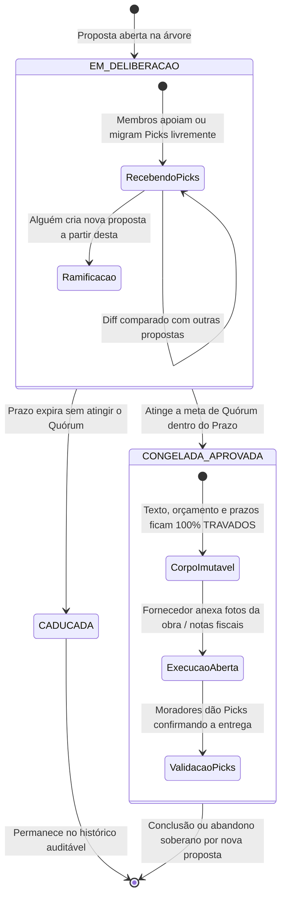

# Módulo 02: Proposal (A Árvore Viva de Decisão)

**Domínio:** Estrutura Livre de Propostas, Diff Universal, Congelamento de Prazos e Execução  
**Arquivo:** `system-design/02_PROPOSAL.md`  

---

## 1. Princípios Fundamentais da Proposta

O módulo **Proposal** é construído sobre dois pilares inegociáveis de soberania humana:
1. **O Poder de se Expressar Livremente:** Nenhuma autoridade, comissão ou moderador pode impedir um membro de criar uma proposta. Qualquer pessoa pode, a qualquer momento, criar uma proposta do zero ou ramificar (*branch/fork*) a partir de **qualquer proposta existente em qualquer versão histórica**.
2. **O Poder de Escolher Livremente:** Cada cidadão direciona seu apoio (`Pick`) para onde a informação e a proposta forem melhores, podendo migrar sua escolha instantaneamente se surgir uma alternativa mais justa e transparente.
3. **Impossibilidade de Engavetamento:** Se uma proposta aprovada não for cumprida ou a comunidade não concordar com os rumos, os membros têm a liberdade absoluta de criar uma nova proposta, atrair os apoios e abandonar a anterior.

```mermaid
graph TD
    classDef propNode fill:#f8fafc,stroke:#334155,stroke-width:1.5px;
    classDef frozen fill:#f1f5f9,stroke:#64748b,stroke-width:2px,stroke-dasharray: 5 5;
    classDef active fill:#f0fdf4,stroke:#16a34a,stroke-width:2px;

    P0["Proposta Raiz (v1)<br/>• Criada por Cidadão A<br/>• Campos: [Texto, Orçamento: 1.200 €]"]:::propNode
    
    P1["Proposta Ramificada (v1.1)<br/>• Criada a partir de v1<br/>• Campos: [Orçamento: 1.800 €, Motor Turbo]"]:::propNode
    
    P2["Proposta Ramificada (v1.2)<br/>• Criada a partir de v1 por Cidadão C<br/>• Campos: [Orçamento: 1.450 €, Bateria]"]:::propNode
    
    P_WIN["Proposta Aprovada (Quórum Batido)<br/>🔒 CONGELADA (Texto e Valores Imutáveis)<br/>🔓 EXECUÇÃO ABERTA (Fotos, Notas e Picks de Entrega)"]:::frozen

    P_NEW["Nova Proposta (Alternativa Soberana)<br/>• Criada a qualquer momento pela comunidade<br/>• Pode abandonar a rota anterior"]:::active

    P0 -->|Ramificação Livre| P1
    P0 -->|Ramificação Livre| P2
    P2 -->|Atingiu Quórum no Prazo| P_WIN
    P_WIN -.->|Comunidade Livre para Criar Outra| P_NEW

    P1 -.->|Diff Universal (Qualquer Nó x Qualquer Nó)| P2
    P0 -.->|Diff Universal| P_WIN
```

---

## 2. Estrutura Livre e Dinâmica da Proposta

A proposta **não possui um formulário rígido imposto**. Ela é um documento modular composto pelos campos que a própria comunidade ou o autor definirem como necessários para aquele assunto:

* Em um assunto de **reforma predial**, os campos necessários serão: *Orçamento*, *Fornecedor*, *Especificações Técnicas*, *Prazos* e *Garantias*.
* Em um assunto de **regras de convivência**, os campos serão: *Texto da Norma*, *Horários Permitidos* e *Critérios*, sem necessidade de campos monetários.
* **Os campos que a compõem ditam as necessidades de deliberação.**

### Tipagem Flexível de Campos:
Cada campo (`ProposalField`) possui uma chave, um tipo semântico e seu valor:
* `CURRENCY`: Valores monetários em centavos inteiros (evita erros de arredondamento);
* `TEXT`: Descrições, finalidades, justificativas;
* `DATE`: Prazos de entrega, datas de vigência;
* `ATTACHMENT`: Imagens, laudos técnicos, plantas, orçamentos em PDF;
* `SELECTION`: Opções pré-definidas (ex: marca A, B ou C).

---

## 3. O Diff Universal ($N \times N$)

Diferente de sistemas rígidos de controle de versão onde você só compara um arquivo com a sua versão imediatamente anterior, no **Sintetize**:
* O cidadão pode **selecionar qualquer Proposta A e qualquer Proposta B** da árvore inteira e solicitar a comparação (`Diff`).
* O motor de Diff faz o pareamento campo a campo:
  1. **Campos Idênticos (Consenso Base):** Exibidos em azul/neutro para leitura rápida;
  2. **Campos Modificados / Divergentes:** Exibidos lado a lado com destaques visuais:
     * Adições e melhorias destacadas em **verde**;
     * Cortes, reduções e substituições destacadas em **vermelho tachado**.

---

## 4. O Ciclo de Vida: Congelamento Temporal e Execução Aberta

O ciclo de uma proposta obedece a uma regra estrita de garantia e segurança:



### Regras do Congelamento:
1. **Corpo Travado:** Quando o prazo é atingido com o quórum necessário, o conteúdo da proposta (orçamento aprovado, escopo, regras) é **congelado criptograficamente**. Ninguém pode alterar o que foi prometido.
2. **Execução Aberta (`Execution`):** Apenas a seção de execução permanece dinâmica para receber:
   * Fotos e evidências da entrega física do serviço;
   * Notas fiscais e comprovantes;
   * **Picks de Confirmação:** Os moradores analisam as fotos e dão seus apoios atestando que o serviço foi de fato entregue conforme prometido para autorizar a liberação financeira.
3. **Soberania de Abandono:** A qualquer momento, se a comunidade perceber que uma proposta aprovada foi mal conduzida ou que as circunstâncias mudaram, qualquer membro pode abrir uma nova proposta e a comunidade pode migrar seus apoios para essa nova direção.

---

## 5. Contratos de Dados TypeScript (Schema do Bloco)

```typescript
export type FieldType = "CURRENCY" | "TEXT" | "DATE" | "ATTACHMENT" | "SELECTION" | "BOOLEAN";

export interface ProposalField {
  key: string;                    // Identificador do campo (ex: "orcamento", "fornecedor")
  label: string;                  // Nome visível (ex: "Orçamento Total")
  type: FieldType;
  value: unknown;                 // Valor preenchido
}

export interface ExecutionProof {
  proofId: string;
  type: "PHOTO" | "INVOICE" | "REPORT";
  fileUrl: string;
  caption: string;
  uploadedAt: number;
  uploadedByPersonaId: string;
  confirmationPickCount: number;  // Apoios de validação desta entrega
}

export interface ProposalNode {
  proposalId: string;             // Hash SHA-256 do conteúdo canônico
  subjectId: string;              // Assunto ao qual pertence
  parentProposalId: string | null;// Proposta-pai da qual foi ramificada (ou null se for raiz)
  authorPersonaId: string;        // Membro que registrou esta proposta
  createdAt: number;
  
  // Estrutura Livre: conjunto dinâmico de campos definidos para esta proposta
  fields: ProposalField[];
  
  // Condições e Prazos
  rule: {
    requiredQuorumPct: number;
  };
  date: {
    deadlineTimestamp: number;
    isFrozen: boolean;            // Fica true quando atinge quórum/prazo
  };
  
  // Contagem de Apoios
  pickCount: number;              // Quantidade atual de apoios ativos neste nó
  
  // Seção de Execução (Única que permanece aberta após o congelamento do corpo)
  execution: {
    status: "NOT_STARTED" | "IN_PROGRESS" | "DELIVERED" | "VERIFIED";
    proofs: ExecutionProof[];
  };
}
```
