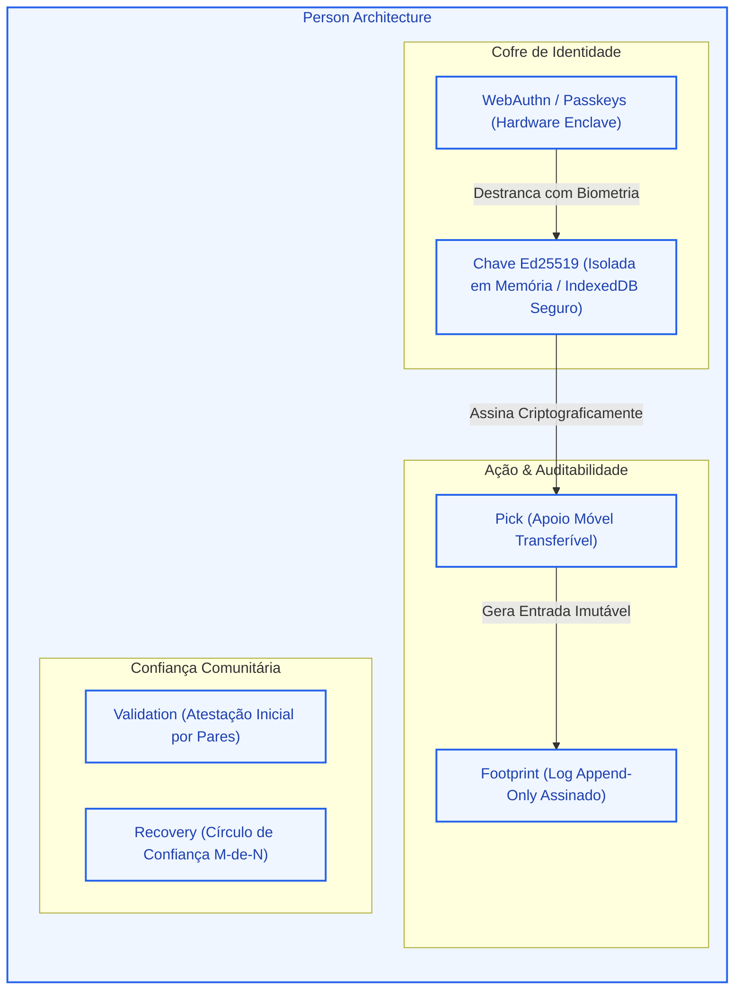

# RFC-003: Person, Cryptographic Identity & Social Trust Architecture

**Documento:** `system-design/03_PERSON.md`  
**Status:** Canonical / Living Document  
**Tipo:** System Design Document (Identity & Cryptography Spec)  
**Autor:** Projeto Sintetize Core Team  
**Última Atualização:** 2026-11-04  

---

## 1. Visão Geral e Filosofia de Identidade

O módulo **Person** é o alicerce de soberania do **Sintetize**. O protocolo rejeita categoricamente modelos de identidade corporativos (contas vinculadas a Google/Apple com vigilância) e rejeita também a complexidade hostil da Web3 clássica (frases mnemônicas de 12 palavras em papel que usuários leigos perdem).

### O Paradoxo Resolvido:
* **Simplicidade Extrema:** Acesso biométrico nativo no smartphone em 30 segundos (TouchID / FaceID via WebAuthn/Passkeys);
* **Criptografia Inviolável:** Par de chaves assimétricas `Ed25519` isolado no hardware seguro do próprio usuário;
* **Recuperação Social Descentralizada:** Se o usuário perder o celular, de 3 a 5 vizinhos de confiança atestam presencialmente sua identidade no novo aparelho, restaurando seu histórico sem intermediários centrais.



---

## 2. Especificação Técnica dos Componentes

### 2.1. O Cofre Biométrico (WebAuthn + Ed25519)
O sistema resolve a ponte entre biometria móvel e assinaturas de alta performance:
1. **Geração de Chaves:** Ao entrar no PWA, o dispositivo gera um par de chaves assimétricas `Ed25519` localmente;
2. **Cofre Encriptado por Hardware:** A chave privada `Ed25519` é encriptada usando `AES-GCM-256` cuja chave simétrica é derivada do enclave de segurança do celular via **WebAuthn PRF** (Pseudo-Random Function) ou assinatura de desafio local;
3. **Assinatura Transparente:** Quando o morador toca o dedo no sensor biométrico, o hardware libera a chave na memória volátil apenas pelo tempo necessário para assinar o `Pick` e zera o buffer em seguida.

### 2.2. A Mecânica do Pick e a Transferência Atômica
* **Invariante de Unicidade:** Para cada `Subject`, cada `Person` pode ter apenas um `Pick` ativo.
* **Transição Atômica de Voto:** Quando a pessoa transfere seu apoio da Proposta $P_A$ para a Proposta $P_B$:
  $$\Delta P_A = -1, \quad \Delta P_B = +1$$
  Essa transição gera um evento assinado que anula o hash do apoio em $P_A$ e valida o hash do apoio em $P_B$.

### 2.3. O Footprint (Rastro Auditável de Integridade)
Toda ação de voto gera uma entrada imutável no log da pessoa:
* Registra o `subjectId`, `proposalId`, `timestamp` e a `signatureEd25519`;
* A comunidade inteira pode auditar e somar os picks conferindo as assinaturas públicas sem depender de um servidor central que possa manipular números.

### 2.4. Validação de Pessoa Real (Atestação por Pares / Anti-Sybil)
* Para exercer o direito de voto em comunidades privadas, a pessoa precisa de um número mínimo de atestações (`minPeerVouches`, ex: 2 atestações de vizinhos existentes);
* Cada vizinho assina digitalmente um atestado declarando: *"Eu reconheço que a Persona 0x4f... reside no condomínio"*;
* Robôs e fazendas de contas falsas são matematicamente incapazes de votar porque não conseguem a assinatura de moradores reais.

### 2.5. Algoritmo de Recuperação Social (Círculo de Confiança M-de-N)
Se o cidadão quebrar ou perder o aparelho:
1. No cadastro, o usuário elege $N$ membros de confiança da comunidade (onde $3 \le N \le 5$);
2. No novo celular, o usuário gera um novo par de chaves provisório e solicita a restauração de sua Persona histórica;
3. O sistema exige uma confirmação com quórum qualificado de $M$ membros (onde $M = \lceil \frac{N+1}{2} \rceil$, ou seja, maioria simples: 2 de 3, ou 3 de 5);
4. Cada membro do círculo de confiança acessa seu app, confere pessoalmente a solicitação e assina um atestado de migração de chave;
5. Atingido o quórum $M$, a rede aceita a nova chave pública como a sucessora legítima da Persona original, preservando todo o seu histórico sem intermediários.

---

## 3. Contratos de Dados TypeScript (Schema de Engenharia)

```typescript
export interface TrustCircleMember {
  personaId: string;
  displayName: string;
  addedAt: number;
}

export interface PickPayload {
  personaId: string;
  subjectId: string;
  targetProposalId: string;
  previousProposalId?: string;    // Se for migração
  timestamp: number;
}

export interface SignedPickEvent {
  payload: PickPayload;
  signatureHex: string;          // Assinatura Ed25519 de 128 caracteres
}

export interface SocialRecoveryRequest {
  targetPersonaId: string;
  newPublicKeyHex: string;
  requestedAt: number;
  approvedVouches: {
    trustMemberPersonaId: string;
    signatureHex: string;
    timestamp: number;
  }[];
  isComplete: boolean;
}

export interface Person {
  personaId: string;             // URN: "urn:sintetize:persona:0x<hex40>"
  publicKeyHex: string;          // Chave pública Ed25519 de 64 caracteres
  displayName: string;
  createdAt: number;
  status: "ACTIVE" | "IN_RECOVERY" | "INACTIVE_STANDBY";
  trustCircle: TrustCircleMember[];
  peerVouchesReceived: {
    voucherPersonaId: string;
    signatureHex: string;
    timestamp: number;
  }[];
}
```
