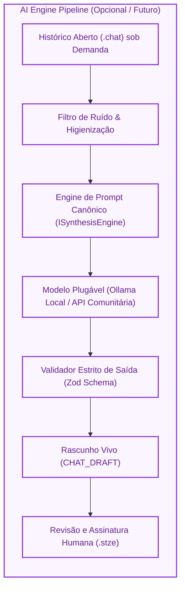

# RFC-004: AI Synthesis Engine & Neutral Mediation Architecture

**Documento:** `system-design/04_AI.md`  
**Status:** Canonical / Living Document  
**Tipo:** System Design Document (AI & Synthesis Engine Spec)  
**Autor:** Projeto Sintetize Core Team  
**Última Atualização:** 2026-11-04  

---

## 1. Visão Geral e Mandato Ético da IA

O módulo **AI** implementa o assistente de mediação e redação neutra do **Sintetize**. Em comunidades humanas reais, debates abertos em grupos de mensagens sofrem com dois males crônicos: **ruído emocional** (discussões paralelas e desabafos) e **exaustão de leitura** (ninguém tem tempo de ler 500 mensagens para entender o que está acontecendo).

### Os 3 Mandamentos Inegociáveis da IA:
1. **Zero Direito a Voto:** A IA **nunca** emite `Pick`, não apoia propostas e não tem preferências pessoais.
2. **Zero Poder de Veto:** A IA não pode barrar, excluir ou engavetar nenhuma proposta humana.
3. **Soberania Humana Estrita:** Qualquer texto produzido pela função `sintetize` é um **rascunho (`DRAFT`) sem valor deliberativo** até que um membro humano decida assiná-lo biometricamente com sua chave `Ed25519`.



---

## 2. Especificação Técnica do Pipeline de Síntese

### 2.1. Ingestão sob Demanda e Filtragem do Histórico `.chat`
* O módulo de IA é **opcional e futuro**: quando acionado sob demanda por um participante, lê o histórico aberto do universo `.chat` daquele `Subject` (sem janela fechada de `Chat time` nem bloqueio de fluxo).
* **Pré-Processamento:** O sanitizador remove repetições idênticas de mensagens e formatações dispersas, agrupando as mensagens cronologicamente com identificação de autor.
* **Isolamento do DAG Imutável:** Como o chat e os rascunhos vivem no universo `.chat` (compactado localmente por assunto em `STZECHAT`), não há expurgo obrigatório nem poluição do grafo imutável `.stze`/`.memb`. A IA apenas preenche um rascunho vivo (`CHAT_DRAFT`) para que um humano o revise, edite e assine quando desejar convertê-lo em proposta oficial `.stze`.

### 2.2. O Algoritmo da Função `sintetize`
O motor executa quatro tarefas em sequência estrita:
1. **Extração de Fatos e Restrições:** Identificar números, valores financeiros, fornecedores, especificações técnicas e datas sugeridas pelos participantes;
2. **Mapeamento de Convergências:** Registrar onde todos concordam (ex: *"Ambos os lados concordam que o portão deve ter abertura em até 3 segundos e garantia mínima de 12 meses"*);
3. **Isolamento de Divergências:** Isolar o trade-off real em debate (ex: *"A divergência concentra-se em pagar 1.200 € por um motor sem bateria ou 1.800 € por um motor com câmera e bateria"*);
4. **Composição da Proposta Equilibrada:** Propor uma versão unificada de meio-termo (ex: *"Motor Turbo 3s com Bateria por 1.450 €, sem os custos extras da câmera"*), gerando os campos estruturados prontos para deliberação.

---

## 3. Template de Prompt Canônico do Sintetizador

```text
Você é o Secretário Neutro de Mediação do Sintetize.
Sua função é ler a transcrição de um debate comunitário e extrair os pontos de acordo,
eliminando ofensas, ruídos emocionais e picuinhas, consolidando uma proposta técnica equilibrada.

Regras Estritas:
1. Você NÃO tem opinião e NÃO toma partido.
2. Seja objetivo, claro e transparente.
3. Responda EXCLUSIVAMENTE em formato JSON cumprindo rigorosamente o Schema estrito fornecido.

Assunto em Debate: {{subjectTitle}}
Descrição do Problema: {{problemDescription}}

Transcrição das Mensagens:
{{chatTranscript}}

Propostas Concorrentes já Existentes:
{{existingProposals}}
```

---

## 4. Contratos de Dados TypeScript e Validação Zod

```typescript
import { z } from "zod";

export const SynthesisDraftSchema = z.object({
  title: z.string().min(5).max(120),
  purpose: z.string().min(10).max(1000),
  suggestedFields: z.array(z.object({
    key: z.string(),
    label: z.string(),
    type: z.enum(["SUBTITLE", "TEXT", "VALUE", "LINK", "TABLE", "ARTICLE"]),
    value: z.unknown()
  })),
  convergencesFound: z.array(z.string().min(5)),
  divergencesRemaining: z.array(z.string().min(5)),
  neutralAnalysisSummary: z.string().min(20).max(800)
});

export type SynthesisDraft = z.infer<typeof SynthesisDraftSchema>;

export interface ISynthesisProvider {
  name: string;
  isLocal: boolean;               // true se rodando via Ollama local, false se API
  synthesize(params: {
    subjectTitle: string;
    transcript: { author: string; text: string; timestamp: number }[];
    competingProposals?: unknown[];
  }): Promise<SynthesisDraft>;
}
```
