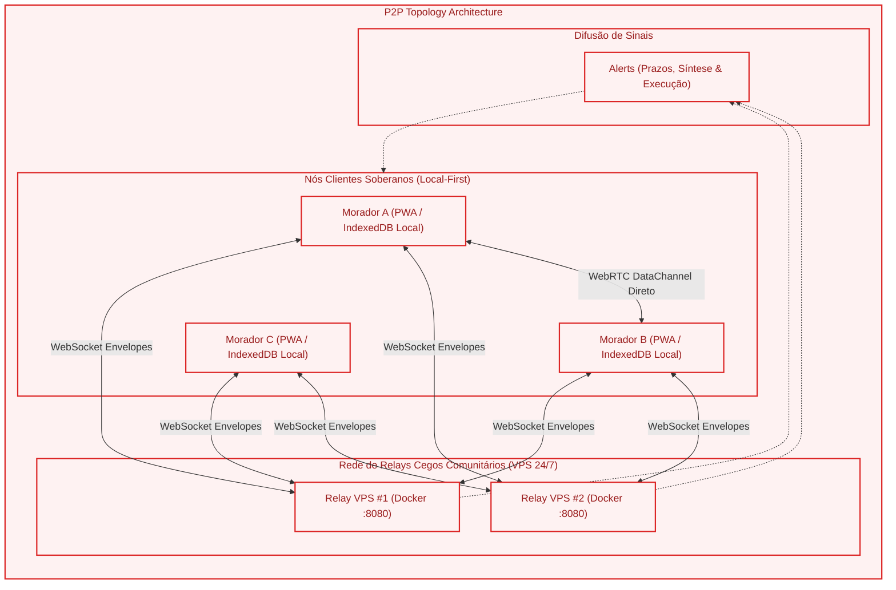

# RFC-005: P2P Network, Blind Relays & Local-First Topology

**Documento:** `system-design/05_P2P.md`  
**Status:** Canonical / Living Document  
**Tipo:** System Design Document (Networking & P2P Protocol Spec)  
**Autor:** Projeto Sintetize Core Team  
**Última Atualização:** 2026-11-04  

---

## 1. Visão Geral e Filosofia de Rede

O módulo **P2P** garante a soberania e a resiliência do **Sintetize**. Em sistemas centralizados tradicionais, se o servidor corporativo cair, for bloqueado judicialmente ou a empresa falir, a comunidade perde todo o seu histórico e capacidade de decidir.

O Sintetize adota uma topologia **Local-First em Duas Camadas**:
* **Nós Móveis Soberanos (`Person`):** Toda a verdade do grafo vive localmente nos celulares dos moradores (armazenamento persistente em IndexedDB / SQLite OPFS). O app funciona 100% offline.
* **Nós de Apoio Comunitário (`VPS`):** Servidores ultraleves neutros (Blind Relays) que retransmitem envelopes assinados 24/7 sem guardar segredos nem inspecionar conteúdos privados.



---

## 2. Especificação Técnica dos Protocolos

### 2.1. O Princípio do Blind Relay (Relay Cego)
* **Zero Custódia e Zero Chaves:** O servidor de relay roda em qualquer máquina modesta ou VPS de R$ 20/mês com **1 comando Docker**:
  ```bash
  docker run -d --restart unless-stopped -p 8080:8080 sintetize/relay:latest
  ```
* **Imunidade a Adulteração:** Todo pacote é assinado pelo emissor com `Ed25519`. Se o operador do VPS tentar adulterar um valor de orçamento ou inventar um voto, o hash SHA-256 e a assinatura quebram e todos os celulares da rede descartam o pacote instantaneamente.
* **Tolerância a Quedas (Failover Automático):** O cliente móvel mantém conexões ativas com 2 ou mais relays configurados. Se um cair, o tráfego chaveia em milissegundos para os restantes sem interrupção perceptível.

### 2.2. Protocolo de Sincronização Offline-First (DAG Sync)
Quando um morador passa dias desconectado e abre o aplicativo:
1. **Troca de Cabeças (Head Exchange):** O celular envia ao relay os últimos hashes de propostas e picks que possui localmente (`knownHeadHashes`);
2. **Download em Lote dos Deltas:** O relay responde com o conjunto de commits e envelopes assinados que o nó ainda não viu;
3. **Validação Determinística Local:** O celular valida a integridade de cada hash e assinatura antes de gravar em seu banco local;
4. **Desconexão Segura:** Uma vez sincronizado, o app pode ser fechado e consome zero dados de segundo plano.

### 2.3. O Subsistema de Alertas Descentralizados (`Alerts`)
O protocolo difunde sinais leves de notificação push e sincronização local:
* `ALERT_DEADLINE_APPROACHING`: "Faltam 24 horas para o fim do prazo do assunto Portão da Garagem";
* `ALERT_NEW_SYNTHESIS`: "Uma proposta unificada foi gerada a partir do debate comunitário";
* `ALERT_ANTI_SNIPING`: "Houve alteração relevante de votos no encerramento; o prazo foi estendido por 24 horas";
* `ALERT_PROOF_UPLOADED`: "O fornecedor anexou fotos da conclusão da obra; venha avaliar para liberar o pagamento".

---

## 3. Contratos de Dados e Envelopamento de Rede

```typescript
export interface SignedNetworkEnvelope {
  topic: string;                  // Ex: "urn:sintetize:comm:bairro-sul:subjects"
  senderPublicKeyHex: string;     // Chave pública Ed25519 do emissor
  actionType: "PROPOSAL_CREATED" | "PICK_CAST" | "EXECUTION_SUBMITTED" | "ALERT_BROADCAST";
  payloadJson: string;            // Conteúdo canônico serializado em JSON
  signatureHex: string;           // Assinatura de 128 caracteres hexadecimais
  timestamp: number;
}

export interface IRelayPoolManager {
  connect(relayUrls: string[]): Promise<void>;
  broadcast(envelope: SignedNetworkEnvelope): Promise<void>;
  subscribe(topic: string, handler: (envelope: SignedNetworkEnvelope) => void): () => void;
  syncCommunityDeltas(communityId: string, knownHeads: string[]): Promise<SignedNetworkEnvelope[]>;
}
```
