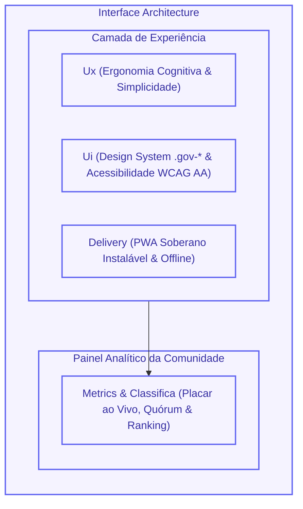

# RFC-006: Interface, Cognitive UX & Delivery Architecture

**Documento:** `system-design/06_INTERFACE.md`  
**Status:** Canonical / Living Document  
**Tipo:** System Design Document (UI/UX & Delivery Spec)  
**Autor:** Projeto Sintetize Core Team  
**Última Atualização:** 2026-11-20  

---

## 1. Visão Geral e Filosofia de Design

O módulo **Interface** é a ponte entre a arquitetura distribuída de alta segurança e a vida cotidiana do cidadão comum. 

O maior fracasso da tecnologia de governança até hoje foi a **hostilidade cognitiva**: forçar pessoas normais (moradores de prédio, agricultores, aposentados) a lidar com termos impenetráveis como *gas*, *hashes*, *sharding* e *contratos inteligentes*.

### O Princípio da Transparência Invisível:
* Toda a segurança criptográfica de ponta roda nos bastidores;
* Na tela, o cidadão encontra apenas uma interface limpa, rápida, acolhedora e acessível:
  * Em vez de *"Sign with private key"*, a tela diz: *"Apoiar com sua digital"*;
  * Em vez de *"Commit hash tree"*, a tela mostra: *"Ver o que mudou (Diff)"*;
  * Em vez de *"Escrow contract execution"*, a tela mostra: *"Conferir a foto do portão instalado"*.



---

## 2. Especificação Técnica dos Componentes de Interface

### 2.1. Ergonomia Cognitiva (Ux) & Componentes M3
* **Área de Toque Inegociável (Padrão Material Design 3):** Todo botão, card de proposta ou elemento clicável respeita a dimensão mínima de **$48 \times 48\text{ dp}$** (classe semântica `.gov-touch-target`, superando o piso mínimo WCAG de $44 \times 44\text{ px}$), prevenindo toques acidentais e facilitando o uso em telas pequenas por idosos;
* **Carga Mental Reduzida:** Um assunto apresenta apenas as informações vitais de decisão: *O que será feito, quanto custa, quem executa, prazos e garantias*;
* **Componentes Oficiais M3:** A interface utiliza exclusivamente componentes estruturados do Material Design 3: `Top App Bar`, `Navigation Bar` (mobile) / `Navigation Rail` (desktop), tonal `Cards`, botões em formato pill (`Filled` para ação principal, `Filled Tonal` para secundárias, `Outlined` para alternativas), `Filter Chips` para seleção no comparador Diff $N \times N$, `Linear Progress Indicator` no termômetro de quórum, `Dialogs`/`Bottom Sheets` e `State Layers` nativas de interação.

### 2.2. Sistema de Design Semântico (Google Material Design 3)
A interface segue estritamente as diretrizes do **Google Material Design 3 (M3)**, com cores tonais suaves escolhidas para transmitir calma e confiança institucional e acessibilidade **WCAG 2.1 AA**:
* **Tipografia Oficial M3:** Família `Roboto` seguindo a *Type Scale* do M3 (`Headline`, `Title`, `Body`, `Label`), com `font-variant-numeric: tabular-nums` em placares, percentuais, datas e valores em reais;
* **Ícones Oficiais M3 (Zero ícones de texto ou emojis):** Biblioteca `Material Symbols Rounded` empacotada localmente para funcionamento 100% offline no PWA (ex.: `how_to_vote`, `fork_right`, `compare_arrows`, `verified_user`, `lock`, `schedule`, `sync`, `groups`). É proibido o uso de emojis ou símbolos de texto improvisados na interface;
* **Superfícies Calmas (Tonal Surfaces):**
  * `--md-sys-color-surface: #F7F9FC` (fundo claro levemente frio para evitar fadiga visual);
  * `--md-sys-color-surface-container: #EEF2F6` (agrupamento sutil);
  * `--md-sys-color-surface-container-lowest: #FFFFFF` com borda `--md-sys-color-outline-variant: #CFD8E3` (cards elevados);
* **Paleta Semântica Tonal Suave (`.gov-*` + M3 Color Roles):**
  * **Azul Ardósia Institucional (`--gov-primary`):** `--md-sys-color-primary: #365B77`, `--md-sys-color-primary-container: #D1E4F5`, `--md-sys-color-on-primary-container: #0E334D` — ações diretas, identidade e foco;
  * **Verde Sálvia Consenso (`--gov-consensus`):** `#265D40` sobre container `#E3F2E9` — propostas com forte adesão, metas atingidas e adições no comparador Diff;
  * **Terracota Suave Exclusão (`--gov-removal`):** `#8F362C` sobre container `#FBEAE7` — gastos cortados, propostas expiradas ou texto removido no comparador Diff;
  * **Âmbar Areia Atenção (`--gov-warning`):** `#785300` sobre container `#FEF3DC` — contagem regressiva de prazos finais e avisos de ciclo.

### 2.3. Delivery Soberano (PWA sem App Stores)
* **Independência de Apple e Google:**
  * O aplicativo é entregue via Progressive Web App moderno (`manifest.webmanifest`);
  * O cidadão instala direto pelo navegador ao ler o QR Code no mural do prédio;
  * Sem cobrança de taxas de loja, sem risco de banimento de desenvolvedor e com atualizações instantâneas;
* **Cache Offline Persistente:** O Service Worker faz cache dos assets estáticos. O app abre em menos de 1 segundo mesmo se o morador estiver na garagem subterrânea sem sinal de celular.

### 2.4. Painel Comunitário: `Metrics & Classifica`
O motor de interface calcula de forma reativa a cada novo pacote de rede:
* **Termômetro de Quórum:** Exibe a meta percentual da comunidade (ex: 75%) com o percentual de apoios atual subindo ou descendo ao vivo conforme os cidadãos transferem seus `Picks`;
* **Ranking de Propostas:** Ordena visualmente as propostas ativas da mais apoiada para a menos apoiada, facilitando que o grupo enxergue onde está a convergência;
* **Painel de Prazos:** Relógio vivo indicando os dias e horas restantes para o fechamento do ciclo.

---

## 3. Contratos de Estado da Interface

```typescript
export interface ProposalCardViewModel {
  proposalId: string;
  title: string;
  authorDisplayName: string;
  summaryProblem: string;
  totalBudgetCents: number;
  deliveryDays: number;
  pickCount: number;
  quorumPercentage: number;
  isLeading: boolean;
  isAiGeneratedSynthesis: boolean;
  isFrozen: boolean;
  hasExecutionProofs: boolean;
}

export interface CommunityDashboardViewModel {
  communityName: string;
  activeSubjectCount: number;
  activeMemberCount: number;
  currentSubject: {
    subjectId: string;
    title: string;
    remainingHours: number;
    quorumTargetPct: number;
    highestProposalPct: number;
    proposalsRanked: ProposalCardViewModel[];
  };
}
```
