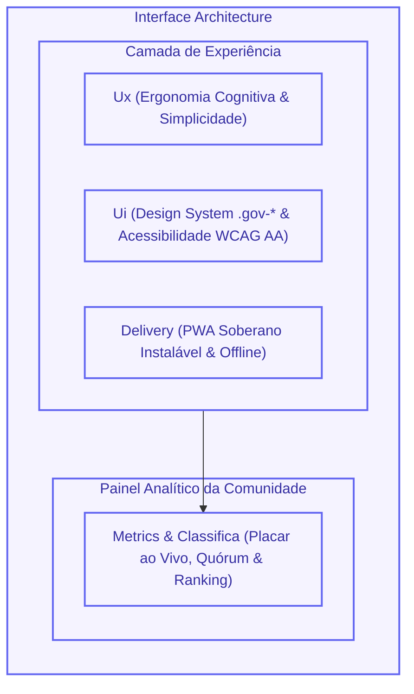

# RFC-006: Interface, Cognitive UX & Delivery Architecture

**Documento:** `system-design/06_INTERFACE.md`  
**Status:** Canonical / Living Document  
**Tipo:** System Design Document (UI/UX & Delivery Spec)  
**Autor:** Projeto Sintetize Core Team  
**Última Atualização:** 2026-11-04  

---

## 1. Visão Geral e Filosofia de Design

O módulo **Interface** é a ponte entre a arquitetura distribuída de alta segurança e a vida cotidiana do cidadão comum. 

O maior fracasso da tecnologia de governança até hoje foi a **hostilidade cognitiva**: forçar pessoas normais (moradores de prédio, agricultores, aposentados) a lidar com termos impenetráveis como *gas*, *hashes*, *sharding* e *contratos inteligentes*.

### O Princípio da Transparência Invisível:
* Toda a segurança criptográfica de ponta roda nos bastidores;
* Na tela, o cidadão encontra apenas uma interface limpa, rápida, acolhedora e acessível:
  * Em vez de *"Sign with private key"*, a tela diz: *"Apoiar com sua digital"*;
  * Em vez de *"Commit hash tree"*, a tela mostra: *"Ver o que mudou (Diff)"*;
  * Em vez de *"Escrow contract execution"*, a tela mostra: *"Conferir a foto do portão instalado"*.



---

## 2. Especificação Técnica dos Componentes de Interface

### 2.1. Ergonomia Cognitiva (Ux)
* **Área de Toque Inegociável:** Todo botão, card de proposta ou elemento clicável respeita a dimensão mínima de **$44 \times 44\text{ px}$** (`.gov-touch-target`), prevenindo toques acidentais e facilitando o uso em telas pequenas por idosos;
* **Carga Mental Reduzida:** Um assunto apresenta apenas as informações vitais de decisão: *O que será feito, quanto custa, quem executa, prazos e garantias*.

### 2.2. Sistema de Design Semântico (Ui Tokens)
O sistema adota uma paleta estrita de significado funcional:
* **Verde Consenso (`--gov-consensus`):** Propostas com forte adesão, metas atingidas e inclusões no comparador de Diffs;
* **Vermelho Exclusão (`--gov-removal`):** Gastos cortados, propostas caducadas ou texto substituído no comparador;
* **Azul Institucional (`--gov-primary`):** Botões de ação direta, identidade biométrica e atestações de pares;
* **Âmbar Atenção (`--gov-warning`):** Prazos finais de ciclo em contagem regressiva viva e avisos anti-sniping.

### 2.3. Delivery Soberano (PWA sem App Stores)
* **Independência de Apple e Google:**
  * O aplicativo é entregue via Progressive Web App moderno (`manifest.webmanifest`);
  * O cidadão instala direto pelo navegador ao ler o QR Code no mural do prédio;
  * Sem cobrança de taxas de loja, sem risco de banimento de desenvolvedor e com atualizações instantâneas;
* **Cache Offline Persistente:** O Service Worker faz cache dos assets estáticos. O app abre em menos de 1 segundo mesmo se o morador estiver na garagem subterrânea sem sinal de celular.

### 2.4. Painel Comunitário: `Metrics & Classifica`
O motor de interface calcula de forma reativa a cada novo pacote de rede:
* **Termômetro de Quórum:** Exibe a meta percentual da comunidade (ex: 75%) com o percentual de apoios atual subindo ou descendo ao vivo conforme os cidadãos transferem seus `Picks`;
* **Ranking de Propostas:** Ordena visualmente as propostas ativas da mais apoiada para a menos apoiada, facilitando que o grupo enxergue onde está a convergência;
* **Painel de Prazos:** Relógio vivo indicando os dias e horas restantes para o fechamento do ciclo.

---

## 3. Contratos de Estado da Interface

```typescript
export interface ProposalCardViewModel {
  proposalId: string;
  title: string;
  authorDisplayName: string;
  summaryProblem: string;
  totalBudgetCents: number;
  deliveryDays: number;
  pickCount: number;
  quorumPercentage: number;
  isLeading: boolean;
  isAiGeneratedSynthesis: boolean;
  isFrozen: boolean;
  hasExecutionProofs: boolean;
}

export interface CommunityDashboardViewModel {
  communityName: string;
  activeSubjectCount: number;
  activeMemberCount: number;
  currentSubject: {
    subjectId: string;
    title: string;
    remainingHours: number;
    quorumTargetPct: number;
    highestProposalPct: number;
    proposalsRanked: ProposalCardViewModel[];
  };
}
```
