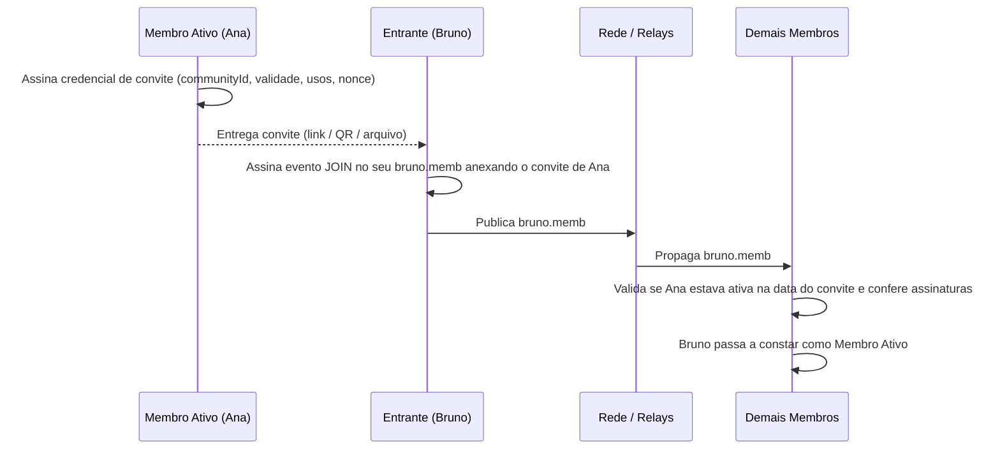
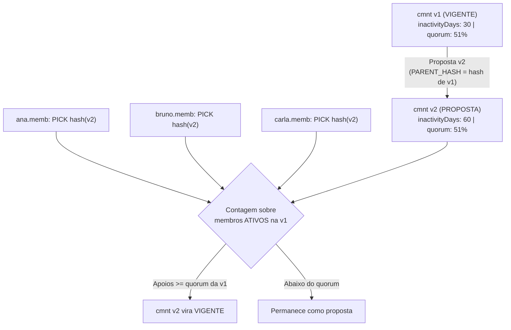

# 07 — Protocolo de Comunidade, Documentos TLV e Sincronização em Escala

> Especificação consolidada das decisões de arquitetura para governança descentralizada no **Sintetize**: um único envelope binário TLV assinável operando sobre quatro universos lógicos (`.cmnt`, `.memb`, `.stze`, `.snap`), permitindo comunidades versionadas por apoio, cálculo determinístico de inatividade, privacidade por escopo e escala para comunidades gigantes.

---

## 1. Princípio Central: O Estado é Calculado, Não Centralizado

No **Sintetize**, não existe banco de dados central decidindo *"quem é membro"*, *"quem está inativo"* ou *"qual regra está valendo"*.

A verdade é o **histórico imutável de documentos binários assinados (Ed25519) e encadeados por hash (`PARENT_HASH`)**. A interface do usuário funciona apenas como:
1. **Leitor e validador** das assinaturas e hashes recebidos.
2. **Calculador determinístico** do estado atual (regras vigentes, membros ativos/inativos, placar de apoios).
3. **Assinador** de novas ações do usuário local.

---

## 2. Um Único Envelope TLV × Quatro Universos Lógicos

Separar os universos em **`.cmnt`**, **`.memb`**, **`.stze`** e **`.snap`** **não torna o sistema mais pesado — torna a rede mais leve**, pois permite sincronização seletiva (ex.: baixar apenas regras ou apenas um assunto específico) sem baixar tudo o tempo todo.

A regra de engenharia para manter o sistema simples é: **todos os quatro universos usam exatamente o mesmo envelope binário TLV e o mesmo validador Ed25519**, mudando apenas a leitura (`docType` / tipo lógico) e o conjunto de tags aceitas no corpo TLV.

### Estrutura Base Compartilhada (alinhada a `packages/wire`)

```text
+---------+---------+-----------+-----+-----------+-----------------------------------+
| version | docType | authorPub | seq | signature | Blocos TLV [tag(1B)|len(2B)|val]  |
|   1B    |   1B    |    32B    | 4B  |    64B    | tamanho variável (máx. ~100 KB)   |
+---------+---------+-----------+-----+-----------+-----------------------------------+
|<------------- 102 bytes de cabeçalho fixo ------------->|<----- payload TLV --------->|
```

* **Preços de escala em binário:** Chave pública (`32B`), hash SHA-256 (`32B`) e assinatura (`64B`) tornam um evento completo de apoio (`pick`) com **~150–180 bytes** — ordem de grandeza menor que JSON.

### Os 4 Universos Lógicos

| Extensão / Universo | Papel no ecossistema | Quem pode assinar | Frequência |
| :--- | :--- | :--- | :--- |
| **`.cmnt`** *(Comunidade)* | Constituição e parâmetros da comunidade: nome, prazo de inatividade (`X` dias), quórum (%), política de convite, referência a subcomunidades/comunidade-mãe e versões (`v1 -> v2 -> v3`). | Qualquer membro **ativo** pode *propor* uma nova versão; ela só entra em vigor ao atingir quórum. | Baixa |
| **`.memb`** *(Membro)* | Log individual de um integrante **dentro de uma comunidade específica**: entrada via convite, alterações de apoio (`picks`) e saída voluntária. | **Apenas o próprio membro** (`authorPub`). Zero conflito de escrita entre membros. | Média |
| **`.stze`** *(Assunto / Síntese)* | Abertura de assuntos, propostas, revisões e execuções/sínteses ligadas à comunidade. | Membros **ativos** segundo o `.cmnt` vigente. | Alta |
| **`.snap`** *(Snapshot / Checkpoint)* | Ponto de consolidação do estado calculado (membros ativos + regra vigente + resultados consolidados) para entrada rápida de novos participantes. | Qualquer membro gera localmente; passa a valer com **quórum de co-assinaturas**. | Periódica |

---

## 3. Escopo do `.memb`, Footprint Enxuto e Federação

### 3.1. Identidade global × `.memb` por comunidade
* **Identidade do usuário (chave Ed25519):** única no ecossistema.
* **Arquivo/log `.memb`:** **sempre escopado por comunidade** `(communityId, memberPubKey)`.

**Motivos:**
1. **Privacidade:** Entrar na Comunidade A não expõe os apoios e vínculos que a pessoa mantém na Comunidade B.
2. **Isolamento de rede:** Participantes da Comunidade A não baixam eventos de outras comunidades.
3. **Comunidade de comunidades:** Uma comunidade-mãe referencia os IDs/hashes das subcomunidades no próprio `.cmnt`, sem misturar os `.memb` entre elas.

### 3.2. Regra do Footprint: Somente Alterações de Apoio (`picks`)
O `.memb` **não** registra cliques, aberturas de tela ou leituras. Ele guarda apenas eventos relevantes de estado e participação:
* `JOIN` (aceite de convite assinado)
* `PICK` / `COMMUNITY_PICK` (alteração de apoio em assunto ou em versão de `.cmnt`)
* `LEAVE` (saída voluntária)

Cada novo evento válido assinado pelo membro atualiza automaticamente o timestamp de última atividade usado para medir inatividade.

---

## 4. Ciclo de Vida e Governança na Prática

### 4.1. Entrada por Convite (`JOIN`)



### 4.2. Saída Voluntária e Inatividade (`inactivityDays`)
* **Saída (`LEAVE`):** O membro assina um evento de saída; após esse evento, sai imediatamente da lista ativa.
* **Inatividade por `X` tempo:** É uma **função de leitura determinística** executada localmente por todos os clientes sobre a cadeia válida:
  - Compara-se a data da última assinatura válida do membro (`.memb` ou `.stze`) com o prazo `inactivityDays` definido na versão vigente do `.cmnt`.
  - Se excedido, o membro é classificado como **Inativo**: seus apoios deixam de contar no denominador/numerador de novos quóruns até que volte a interagir ou seja reativado conforme a regra vigente. Isso impede que comunidades travem por abandono de antigos integrantes.

### 4.3. Versionamento de Regras por Apoio (`.cmnt` v1 → v2)



---

## 5. Escalabilidade: Comunidades Gigantes e `.snap`

### 5.1. Interface em `O(1)` via Indexação Incremental
O aplicativo **nunca** reprocessa todos os `.memb` do zero ao abrir um assunto. Ao receber um evento novo da rede, ele atualiza um índice materializado local (ex.: `IndexedDB`):
- Mantém o último apoio válido de cada `(membro, alvo)`.
- Atualiza o placar incrementalmente (`placar[antigo] -= 1`, `placar[novo] += 1`).

Assim, exibir o ranking de propostas e o percentual de quórum leva milissegundos mesmo com dezenas de milhares de membros.

### 5.2. Comportamento dos Snapshots (`.snap`) na Rede
Para que um membro novo não precise baixar anos de histórico ao entrar em uma comunidade gigante:

1. **Construção determinística:** Como todos os clientes executam as mesmas regras sobre os mesmos pacotes, qualquer membro calcula exatamente o mesmo resumo de estado até um marco (`upToHash` / timestamp).
2. **Validação sem servidor central:** O `.snap` torna-se confiável quando atinge o **quórum de co-assinaturas** de membros ativos sobre o mesmo hash do snapshot.
3. **Sync rápido vs. Histórico completo:**
   - **Nós leves (padrão em navegador/celular):** Baixam apenas o último `.snap` validado por quórum + os pacotes posteriores a ele.
   - **Nós de arquivo / relays / auditores:** Preservam o histórico bruto completo desde a gênese (`.cmnt` v1 e todos os `.memb`/`.stze`). Qualquer usuário pode, se desejar auditar, baixar o passado completo e verificar que a consolidação reproduz o mesmo hash do `.snap`.

---

## 6. Especificação Sugerida de Tags TLV por Universo

Mantendo compatibilidade com as tags já implementadas em `packages/wire/src/types.ts` (`SCOPE=1`, `PARENT_HASH=2`, `TITLE=10`, `BODY=11`, `CURRENCY=12`, `DEADLINE=13`, `LAW_ARTICLE=14`, `AUTHOR_NAME=15`, `QUORUM_PCT=16`, `CONFIG_KIND=17`, `PICK_TARGET=20`):

### Tags base comuns (presentes conforme necessidade em todos os pacotes)
- `SCOPE (1)`: `communityId` (ou escopo `communityId/subjectId`).
- `PARENT_HASH (2)`: SHA-256 (`32B`) do documento/evento anterior na cadeia.
- `TIMESTAMP` *(nova tag sugerida)*: `Uint64BE` (`8B`) em milissegundos UTC para ordenação e cálculo de inatividade.

### Mapa de conteúdo específico
* **`.cmnt` *(Regras e Versões da Comunidade)*:** `CONFIG_KIND (17)`, `TITLE (10)`, `BODY (11)`, `QUORUM_PCT (16)`, `DEADLINE (13)`, mais novas tags planejadas para `INACTIVITY_DAYS` e `PARENT_COMMUNITY_HASH` (para comunidade de comunidades).
* **`.memb` *(Log do Membro na Comunidade)*:**
  - Entrada: subtipo `JOIN` + bloco com credencial do convite assinado pelo convidante (`INVITE_PROOF`) + `AUTHOR_NAME (15)`.
  - Apoio/Footprint: subtipo `PICK` / `COMMUNITY_PICK` + `PICK_TARGET (20)` (`32B`, hash de proposta em `.stze` ou hash de versão em `.cmnt`).
  - Saída: subtipo `LEAVE`.
* **`.stze` *(Assuntos e Sínteses)*:** `TITLE (10)`, `BODY (11)`, `CURRENCY (12)`, `DEADLINE (13)`, `LAW_ARTICLE (14)`, `PARENT_HASH (2)`.
* **`.snap` *(Checkpoint Assinado)*:** `PARENT_HASH (2)` (hash do snapshot anterior), `CUTOFF_HASH` (`32B`), `ACTIVE_CMNT_HASH` (`32B`), tabela compacta de membros ativos (`authorPub + lastActivityTs`) e lista de co-assinaturas (`pubKey + sig`) atingindo o quórum.

---

## 7. Camada de Rede Decidida: Nostr (`nostr-tools`)

* **Decisão fechada:** Migrar a camada de rede do relay WebSocket caseiro para **Nostr (`nostr-tools`)**, reduzindo código de infraestrutura própria e ganhando redundância em múltiplos relays prontos.
* **O que o Relay Nostr faz:** Continua sendo apenas uma **caixa postal burra** que armazena eventos imutáveis e permite filtrar por tags da comunidade e por universo (`.cmnt`, `.memb`, `.stze`, `.snap`). Ele nunca decide quórum nem valida governança.
* **Por que TLV próprio + transporte Nostr (sem Automerge):**
  - CRDTs genéricos não validam regras rígidas de governança (impedir voto de inativo, exigir convite válido, exigir quórum para trocar `v1 -> v2`).
  - O pacote TLV binário assinado (Ed25519) viaja em Base64 no `content` de um evento Nostr regular/imutável, com tags de filtro (`communityId`, universo e hash). Todo cliente valida a assinatura e o `PARENT_HASH` internos antes de aceitar o pacote.
* **Referência dos tipos de documento:** Ver o catálogo simplificado em [08_TLV_DOCUMENT_TYPES.md](file:///Users/MarcosBaiadori/Desktop/sintetizing/system-design/08_TLV_DOCUMENT_TYPES.md).
